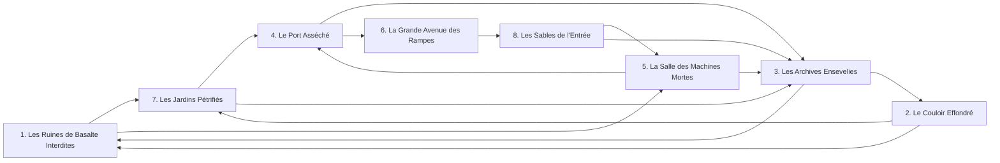

# La Cité de Yith : lieux et progression

## Carte des liens



## Tableau des liens

| # | Lieu | Mène à | Mène à |
|---|------|--------|--------|
| 1 | Les Ruines de Basalte Interdites | 7. Les Jardins Pétrifiés | 5. La Salle des Machines Mortes |
| 2 | Le Couloir Effondré | 1. Les Ruines de Basalte Interdites | 7. Les Jardins Pétrifiés |
| 3 | Les Archives Ensevelies | 1. Les Ruines de Basalte Interdites | 2. Le Couloir Effondré |
| 4 | Le Port Asséché | 3. Les Archives Ensevelies | 6. La Grande Avenue des Rampes |
| 5 | La Salle des Machines Mortes | 4. Le Port Asséché | 3. Les Archives Ensevelies |
| 6 | La Grande Avenue des Rampes | 8. Les Sables de l'Entrée | 8. Les Sables de l'Entrée |
| 7 | Les Jardins Pétrifiés | 4. Le Port Asséché | 3. Les Archives Ensevelies |
| 8 | Les Sables de l'Entrée | 5. La Salle des Machines Mortes | 3. Les Archives Ensevelies |

## Lieux et prompts

### 1. Les Ruines de Basalte Interdites (départ)

Mène à : **7. Les Jardins Pétrifiés** et **5. La Salle des Machines Mortes**

```
Ruines millénaires abandonnées, à demi ensevelies dans le désert australien aride, de nos jours. Aucun personnage, aucune créature, aucune trace d'eau ; seulement de la pierre érodée, du sable et des objets brisés. Édifice de basalte noir sans fenêtres, plus ancien que la cité, une trappe massive scellée au sol, fissurée, du sable qui s'écoule dans ses fentes, une impression de menace venue d'en dessous. Peinture numérique réaliste à la texture de gouache, ocre doré, ombres olive et bronze oxydé. Paysage 16:9, 1536 × 864 px, scène unique plein cadre, sans inscriptions, bordure, signature ni filigrane.
```

### 2. Le Couloir Effondré

Mène à : **1. Les Ruines de Basalte Interdites** et **7. Les Jardins Pétrifiés**

```
Ruines millénaires abandonnées, à demi ensevelies dans le désert australien aride, de nos jours. Aucun personnage, aucune créature, aucune trace d'eau ; seulement de la pierre érodée, du sable et des objets brisés. Galerie souterraine écroulée, des blocs cyclopéens fendus, du sable qui s'infiltre en cascades sèches par les fissures, une étroite clarté au fond du passage. Peinture numérique réaliste à la texture de gouache, ocre doré, ombres olive et bronze oxydé. Paysage 16:9, 1536 × 864 px, scène unique plein cadre, sans inscriptions, bordure, signature ni filigrane.
```

### 3. Les Archives Ensevelies

Mène à : **1. Les Ruines de Basalte Interdites** et **2. Le Couloir Effondré**

```
Ruines millénaires abandonnées, à demi ensevelies dans le désert australien aride, de nos jours. Aucun personnage, aucune créature, aucune trace d'eau ; seulement de la pierre érodée, du sable et des objets brisés. Bibliothèque souterraine immense et silencieuse. Des étagères rectilignes renversées, des étuis de métal grisâtre cabossés et ouverts jonchent le sol, la poussière flotte dans un rai de lumière tombé d'une fissure. Peinture numérique réaliste à la texture de gouache, ocre doré, ombres olive et bronze oxydé. Paysage 16:9, 1536 × 864 px, scène unique plein cadre, sans inscriptions, bordure, signature ni filigrane.
```

### 4. Le Port Asséché

Mène à : **3. Les Archives Ensevelies** et **6. La Grande Avenue des Rampes**

```
Ruines millénaires abandonnées, à demi ensevelies dans le désert australien aride, de nos jours. Aucun personnage, aucune créature, aucune trace d'eau ; seulement de la pierre érodée, du sable et des objets brisés. Quais de pierre cyclopéens dominant une ancienne mer devenue plaine de sel craquelé et de sable, des carcasses d'embarcations aux formes non humaines réduites à des armatures de métal rongé. Peinture numérique réaliste à la texture de gouache, ocre doré, ombres olive et bronze oxydé. Paysage 16:9, 1536 × 864 px, scène unique plein cadre, sans inscriptions, bordure, signature ni filigrane.
```

### 5. La Salle des Machines Mortes

Mène à : **4. Le Port Asséché** et **3. Les Archives Ensevelies**

```
Ruines millénaires abandonnées, à demi ensevelies dans le désert australien aride, de nos jours. Aucun personnage, aucune créature, aucune trace d'eau ; seulement de la pierre érodée, du sable et des objets brisés. Vaste salle voûtée à moitié remplie de sable, des machines étranges de métal corrodé et de cristal fêlé, démantelées et figées dans des alcôves vides, éclairées par une lumière pâle venue d'en haut. Peinture numérique réaliste à la texture de gouache, ocre doré, ombres olive et bronze oxydé. Paysage 16:9, 1536 × 864 px, scène unique plein cadre, sans inscriptions, bordure, signature ni filigrane.
```

### 6. La Grande Avenue des Rampes

Mène à : **8. Les Sables de l'Entrée**

```
Ruines millénaires abandonnées, à demi ensevelies dans le désert australien aride, de nos jours. Aucun personnage, aucune créature, aucune trace d'eau ; seulement de la pierre érodée, du sable et des objets brisés. Avenue colossale comblée de sable, bordée de tours de basalte écroulées aux toits convexes éventrés. De larges rampes inclinées, brisées, mènent vers des niveaux disparus, sous un soleil écrasant. Peinture numérique réaliste à la texture de gouache, ocre doré, ombres olive et bronze oxydé. Paysage 16:9, 1536 × 864 px, scène unique plein cadre, sans inscriptions, bordure, signature ni filigrane.
```

### 7. Les Jardins Pétrifiés

Mène à : **4. Le Port Asséché** et **3. Les Archives Ensevelies**

```
Ruines millénaires abandonnées, à demi ensevelies dans le désert australien aride, de nos jours. Aucun personnage, aucune créature, aucune trace d'eau ; seulement de la pierre érodée, du sable et des objets brisés. Terrasses en surplomb couvertes de sable, où ne restent que des troncs de fougères géantes fossilisés et des empreintes de plantes dans la pierre. Des balustrades massives effondrées dominent un désert sans fin. Peinture numérique réaliste à la texture de gouache, ocre doré, ombres olive et bronze oxydé. Paysage 16:9, 1536 × 864 px, scène unique plein cadre, sans inscriptions, bordure, signature ni filigrane.
```

### 8. Les Sables de l'Entrée

Mène à : **5. La Salle des Machines Mortes** et **3. Les Archives Ensevelies**

```
Ruines millénaires abandonnées, à demi ensevelies dans le désert australien aride, de nos jours. Aucun personnage, aucune créature, aucune trace d'eau ; seulement de la pierre érodée, du sable et des objets brisés. Sous un ciel étoilé immense, des blocs cyclopéens sculptés et fendus émergent à peine des dunes de sable rouge. Une ouverture sombre s'enfonce sous la terre entre deux dalles basculées. Peinture numérique réaliste à la texture de gouache, ocre doré, ombres olive et bronze oxydé. Paysage 16:9, 1536 × 864 px, scène unique plein cadre, sans inscriptions, bordure, signature ni filigrane.
```
