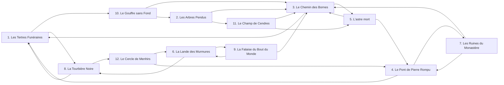

# Les Abysses : lieux et progression

## Carte des liens



## Tableau des liens

| # | Lieu | Mène à | Mène à |
|---|------|--------|--------|
| 1 | Les Tertres Funéraires | 10. Le Gouffre sans Fond | 8. La Tourbière Noire |
| 2 | Les Arbres Pendus | 3. Le Chemin des Bornes | 11. Le Champ de Cendres |
| 3 | Le Chemin des Bornes | 1. Les Tertres Funéraires | 5. L'astre mort |
| 4 | Le Pont de Pierre Rompu | 1. Les Tertres Funéraires | 7. Les Ruines du Monastère |
| 5 | L'astre mort | 4. Le Pont de Pierre Rompu | 3. Le Chemin des Bornes |
| 6 | La Lande des Murmures | 9. La Falaise du Bout du Monde | 8. La Tourbière Noire |
| 7 | Les Ruines du Monastère | 4. Le Pont de Pierre Rompu | 3. Le Chemin des Bornes |
| 8 | La Tourbière Noire | 12. Le Cercle de Menhirs | 1. Les Tertres Funéraires |
| 9 | La Falaise du Bout du Monde | 3. Le Chemin des Bornes | 6. La Lande des Murmures |
| 10 | Le Gouffre sans Fond | 3. Le Chemin des Bornes | 2. Les Arbres Pendus |
| 11 | Le Champ de Cendres | 3. Le Chemin des Bornes | 5. L'astre mort |
| 12 | Le Cercle de Menhirs | 6. La Lande des Murmures | 4. Le Pont de Pierre Rompu |

## Lieux et prompts

### 1. Les Tertres Funéraires (départ)

Mène à : **10. Le Gouffre sans Fond** et **8. La Tourbière Noire**

```
Les Abysses, un autre monde hors du temps : des landes désolées et sombres sous un ciel bas et sans étoiles, éclairées par une lueur blafarde sans source. Aucun personnage humain ; de la roche noire, de la bruyère morte, de la brume et des vestiges brisés. Collines basses et régulières alignées sur la lande, des tumulus ouverts aux entrées de pierre effondrées, des fragments d'urnes et de bronze verdi éparpillés dans l'herbe morte. Peinture numérique réaliste à la texture de gouache, ocre doré, ombres olive et bronze oxydé. Paysage 16:9, 1536 × 864 px, scène unique plein cadre, sans inscriptions, bordure, signature ni filigrane.
```

### 2. Les Arbres Pendus

Mène à : **3. Le Chemin des Bornes** et **11. Le Champ de Cendres**

```
Les Abysses, un autre monde hors du temps : des landes désolées et sombres sous un ciel bas et sans étoiles, éclairées par une lueur blafarde sans source. Aucun personnage humain ; de la roche noire, de la bruyère morte, de la brume et des vestiges brisés. Bosquet d'arbres morts, noirs et tordus, aux branches nues qui griffent un ciel bas, des chaînes rouillées et brisées pendent de leurs branches, le sol couvert de feuilles grises où luisent faiblement quelques petits champignons pâles. Peinture numérique réaliste à la texture de gouache, ocre doré, ombres olive et bronze oxydé. Paysage 16:9, 1536 × 864 px, scène unique plein cadre, sans inscriptions, bordure, signature ni filigrane.
```

### 3. Le Chemin des Bornes

Mène à : **1. Les Tertres Funéraires** et **5. L'astre mort**

```
Les Abysses, un autre monde hors du temps : des landes désolées et sombres sous un ciel bas et sans étoiles, éclairées par une lueur blafarde sans source. Aucun personnage humain ; de la roche noire, de la bruyère morte, de la brume et des vestiges brisés. Sentier de dalles disjointes qui serpente à travers la lande, jalonné de bornes de pierre érodées et couvertes de lichen, se perdant dans la brume. Peinture numérique réaliste à la texture de gouache, ocre doré, ombres olive et bronze oxydé. Paysage 16:9, 1536 × 864 px, scène unique plein cadre, sans inscriptions, bordure, signature ni filigrane.
```

### 4. Le Pont de Pierre Rompu

Mène à : **1. Les Tertres Funéraires** et **7. Les Ruines du Monastère**

```
Les Abysses, un autre monde hors du temps : des landes désolées et sombres sous un ciel bas et sans étoiles, éclairées par une lueur blafarde sans source. Aucun personnage humain ; de la roche noire, de la bruyère morte, de la brume et des vestiges brisés. Arche de pierre colossale au-dessus d'un ravin obscur, brisée en son milieu, ses deux moitiés tendues l'une vers l'autre sans se toucher, des fissures fraîches et quelques éclats de pierre qui tombent encore dans le vide. Peinture numérique réaliste à la texture de gouache, ocre doré, ombres olive et bronze oxydé. Paysage 16:9, 1536 × 864 px, scène unique plein cadre, sans inscriptions, bordure, signature ni filigrane.
```

### 5. L'astre mort

Mène à : **4. Le Pont de Pierre Rompu** et **3. Le Chemin des Bornes**

```
Les Abysses, un autre monde hors du temps : des landes désolées et sombres sous un ciel bas et sans étoiles, éclairées par une lueur blafarde sans source. Aucun personnage humain ; de la roche noire, de la bruyère morte, de la brume et des vestiges brisés. Un astre mort dans l'air flotte au-dessus de la lande, ses bords luisent faiblement, l'herbe rase et noircie s'étend à perte de vue autour d'elle. Peinture numérique réaliste à la texture de gouache, ocre doré, ombres olive et bronze oxydé. Paysage 16:9, 1536 × 864 px, scène unique plein cadre, sans inscriptions, bordure, signature ni filigrane.
```

### 6. La Lande des Murmures

Mène à : **9. La Falaise du Bout du Monde** et **8. La Tourbière Noire**

```
Les Abysses, un autre monde hors du temps : des landes désolées et sombres sous un ciel bas et sans étoiles, éclairées par une lueur blafarde sans source. Aucun personnage humain ; de la roche noire, de la bruyère morte, de la brume et des vestiges brisés. Étendue immense de bruyère sèche et grise couchée par un vent invisible, des écharpes de brume rampent au ras du sol, l'horizon se perd dans l'obscurité, où se devine très loin une silhouette massive et immobile. Peinture numérique réaliste à la texture de gouache, ocre doré, ombres olive et bronze oxydé. Paysage 16:9, 1536 × 864 px, scène unique plein cadre, sans inscriptions, bordure, signature ni filigrane.
```

### 7. Les Ruines du Monastère

Mène à : **4. Le Pont de Pierre Rompu** et **3. Le Chemin des Bornes**

```
Les Abysses, un autre monde hors du temps : des landes désolées et sombres sous un ciel bas et sans étoiles, éclairées par une lueur blafarde sans source. Aucun personnage humain ; de la roche noire, de la bruyère morte, de la brume et des vestiges brisés. Murs effondrés d'un édifice ancien sur un éperon rocheux, des arcs brisés ouverts sur le vide, une cloche de bronze fendue renversée dans les décombres, et dans un coin un bassin de pierre ébréché à l'eau d'encre où affleurent de petits poissons noirs aux yeux vides. Peinture numérique réaliste à la texture de gouache, ocre doré, ombres olive et bronze oxydé. Paysage 16:9, 1536 × 864 px, scène unique plein cadre, sans inscriptions, bordure, signature ni filigrane.
```

### 8. La Tourbière Noire

Mène à : **12. Le Cercle de Menhirs** et **1. Les Tertres Funéraires**

```
Les Abysses, un autre monde hors du temps : des landes désolées et sombres sous un ciel bas et sans étoiles, éclairées par une lueur blafarde sans source. Aucun personnage humain ; de la roche noire, de la bruyère morte, de la brume et des vestiges brisés. Tourbière sombre et figée, sans le moindre reflet, hérissée de souches mortes et de joncs desséchés, un sol spongieux et noir qui semble respirer. Peinture numérique réaliste à la texture de gouache, ocre doré, ombres olive et bronze oxydé. Paysage 16:9, 1536 × 864 px, scène unique plein cadre, sans inscriptions, bordure, signature ni filigrane.
```

### 9. La Falaise du Bout du Monde

Mène à : **3. Le Chemin des Bornes** et **6. La Lande des Murmures**

```
Les Abysses, un autre monde hors du temps : des landes désolées et sombres sous un ciel bas et sans étoiles, éclairées par une lueur blafarde sans source. Aucun personnage humain ; de la roche noire, de la bruyère morte, de la brume et des vestiges brisés. Falaise abrupte où la lande s'arrête net au-dessus d'un néant brumeux et sans fond, un pic rocheux isolé à l'extrémité, une lueur pâle tout au loin où plane une minuscule forme ailée. Peinture numérique réaliste à la texture de gouache, ocre doré, ombres olive et bronze oxydé. Paysage 16:9, 1536 × 864 px, scène unique plein cadre, sans inscriptions, bordure, signature ni filigrane.
```

### 10. Le Gouffre sans Fond

Mène à : **3. Le Chemin des Bornes** et **2. Les Arbres Pendus**

```
Les Abysses, un autre monde hors du temps : des landes désolées et sombres sous un ciel bas et sans étoiles, éclairées par une lueur blafarde sans source. Aucun personnage humain ; de la roche noire, de la bruyère morte, de la brume et des vestiges brisés. Faille gigantesque qui fend la lande, ses parois de roche noire plongent dans une obscurité absolue, des pierres détachées en suspens au bord, une fine brume qui s'élève des profondeurs. Peinture numérique réaliste à la texture de gouache, ocre doré, ombres olive et bronze oxydé. Paysage 16:9, 1536 × 864 px, scène unique plein cadre, sans inscriptions, bordure, signature ni filigrane.
```

### 11. Le Champ de Cendres

Mène à : **3. Le Chemin des Bornes** et **5. L'astre mort**

```
Les Abysses, un autre monde hors du temps : des landes désolées et sombres sous un ciel bas et sans étoiles, éclairées par une lueur blafarde sans source. Aucun personnage humain ; de la roche noire, de la bruyère morte, de la brume et des vestiges brisés. Plaine couverte de cendre grise et fine, des formes calcinées indéfinissables à demi enfouies, des volutes de fumée froide qui montent de crevasses, une forme voûtée à peine discernable à la lisière de la brume. Peinture numérique réaliste à la texture de gouache, ocre doré, ombres olive et bronze oxydé. Paysage 16:9, 1536 × 864 px, scène unique plein cadre, sans inscriptions, bordure, signature ni filigrane.
```

### 12. Le Cercle de Menhirs

Mène à : **6. La Lande des Murmures** et **4. Le Pont de Pierre Rompu**

```
Les Abysses, un autre monde hors du temps : des landes désolées et sombres sous un ciel bas et sans étoiles, éclairées par une lueur blafarde sans source. Aucun personnage humain ; de la roche noire, de la bruyère morte, de la brume et des vestiges brisés. Cercle de pierres levées noires et penchées sur une butte nue, certaines fendues ou renversées, une dalle centrale craquelée, la brume tourne lentement autour. Peinture numérique réaliste à la texture de gouache, ocre doré, ombres olive et bronze oxydé. Paysage 16:9, 1536 × 864 px, scène unique plein cadre, sans inscriptions, bordure, signature ni filigrane.
```
