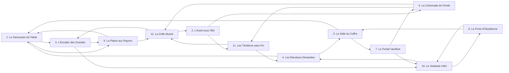

# Une autre dimension : lieux et progression

## Carte des liens



## Tableau des liens

| # | Lieu | Mène à | Mène à |
|---|------|--------|--------|
| 1 | Le Sanctuaire de l'Idole | 5. L'Escalier des Gravités | 9. La Plaine aux Rayons |
| 2 | L'Autel sous l'Œil | 11. Les Ténèbres sans Fin | 6. La Colonnade de l'Onde |
| 3 | La Salle du Coffre | 1. Le Sanctuaire de l'Idole | 7. Le Portail Vacillant |
| 4 | Les Étendues Dévastées | 1. Le Sanctuaire de l'Idole | 3. La Salle du Coffre |
| 5 | L'Escalier des Gravités | 9. La Plaine aux Rayons | 10. Le Vestibule Infini |
| 6 | La Colonnade de l'Onde | 11. Les Ténèbres sans Fin | 12. La Grille Murée |
| 7 | Le Portail Vacillant | 10. Le Vestibule Infini | 6. La Colonnade de l'Onde |
| 8 | La Porte d'Obsidienne | 3. La Salle du Coffre | 10. Le Vestibule Infini |
| 9 | La Plaine aux Rayons | 12. La Grille Murée | 1. Le Sanctuaire de l'Idole |
| 10 | Le Vestibule Infini | 4. Les Étendues Dévastées | 8. La Porte d'Obsidienne |
| 11 | Les Ténèbres sans Fin | 12. La Grille Murée | 4. Les Étendues Dévastées |
| 12 | La Grille Murée | 5. L'Escalier des Gravités | 2. L'Autel sous l'Œil |

## Lieux et prompts

### 1. Le Sanctuaire de l'Idole (départ)

Mène à : **5. L'Escalier des Gravités** et **9. La Plaine aux Rayons**

```
Illustre une petite idole d'or posée sur un piédestal flottant, dont l'ombre tombe sur un mur absent. Très loin derrière, une forme immense et endormie s'enroule autour d'une lune laiteuse, à peine distincte du fond étoilé. Ambiance spatiale et irréelle, aucun personnage humain. Rends chaque surface et chaque ombre crédible pour que l'étrangeté vienne de la géométrie. Peinture numérique réaliste à la texture de gouache, gris d'argent, indigo et reflets opalins. Paysage 16:9, 1536 × 864 px, scène unique plein cadre, sans texte, bordure, signature ni filigrane.
```

### 2. L'Autel sous l'Œil

Mène à : **11. Les Ténèbres sans Fin** et **6. La Colonnade de l'Onde**

```
Illustre l'intérieur d'une sphère creuse dont la paroi porte des autels de pierre identiques, tous orientés vers le centre. Un parchemin roulé repose sur l'autel au premier plan. Au cœur de la sphère, une nébuleuse indigo évoque, à peine, une pupille. Ambiance spatiale et irréelle, aucun personnage humain. Rends chaque surface et chaque ombre crédible pour que l'étrangeté vienne de la géométrie. Peinture numérique réaliste à la texture de gouache, gris d'argent, indigo et reflets opalins. Paysage 16:9, 1536 × 864 px, scène unique plein cadre, sans texte, bordure, signature ni filigrane.
```

### 3. La Salle du Coffre

Mène à : **1. Le Sanctuaire de l'Idole** et **7. Le Portail Vacillant**

```
Illustre une salle dont chaque mur est le sol d'une gravité différente. Un coffre de pierre massif repose sur le plafond, le couvercle entrouvert. Des feuillets anciens tombent dans quatre directions à la fois et restent figés en pleine chute. Ambiance spatiale et irréelle, aucun personnage humain. Rends chaque surface et chaque ombre crédible pour que l'étrangeté vienne de la géométrie. Peinture numérique réaliste à la texture de gouache, gris d'argent, indigo et reflets opalins. Paysage 16:9, 1536 × 864 px, scène unique plein cadre, sans texte, bordure, signature ni filigrane.
```

### 4. Les Étendues Dévastées

Mène à : **1. Le Sanctuaire de l'Idole** et **3. La Salle du Coffre**

```
Illustre une plaine de roche fracturée qui se recourbe à l'horizon jusqu'à passer au-dessus de la tête, comme l'intérieur d'un cylindre géant. La poussière tourne en une spirale lente. Par les failles du sol, on aperçoit des planètes pâles. Ambiance spatiale et irréelle, aucun personnage humain. Rends chaque surface et chaque ombre crédible pour que l'étrangeté vienne de la géométrie. Peinture numérique réaliste à la texture de gouache, gris d'argent, indigo et reflets opalins. Paysage 16:9, 1536 × 864 px, scène unique plein cadre, sans texte, bordure, signature ni filigrane.
```

### 5. L'Escalier des Gravités

Mène à : **9. La Plaine aux Rayons** et **10. Le Vestibule Infini**

```
Illustre une dimension où plusieurs directions de gravité coexistent. Une ancienne volée de marches monte au centre et se raccorde au flanc d'un mur qui devient le sol d'une autre pièce. Deux arches ouvrent sur des ciels incompatibles, l'un laiteux et l'autre étoilé. De petits éclats de pierre restent immobiles dans le vide entre les deux. Ambiance spatiale et irréelle, aucun personnage humain. Rends chaque surface et chaque ombre crédible pour que l'étrangeté vienne de la géométrie. Peinture numérique réaliste à la texture de gouache, gris d'argent, indigo et reflets opalins. Paysage 16:9, 1536 × 864 px, scène unique plein cadre, sans texte, bordure, signature ni filigrane.
```

### 6. La Colonnade de l'Onde

Mène à : **11. Les Ténèbres sans Fin** et **12. La Grille Murée**

```
Illustre une longue colonnade de pierre suspendue dans l'espace, traversée par une onde visible qui courbe les colonnes comme des reflets dans l'eau, alors que la pierre reste parfaitement solide. Au-delà de l'onde, les étoiles sont décalées. Ambiance spatiale et irréelle, aucun personnage humain. Rends chaque surface et chaque ombre crédible pour que l'étrangeté vienne de la géométrie. Peinture numérique réaliste à la texture de gouache, gris d'argent, indigo et reflets opalins. Paysage 16:9, 1536 × 864 px, scène unique plein cadre, sans texte, bordure, signature ni filigrane.
```

### 7. Le Portail Vacillant

Mène à : **10. Le Vestibule Infini** et **6. La Colonnade de l'Onde**

```
Illustre un portail circulaire suspendu dans le vide étoilé, que l'on voit à la fois de face et de profil. À travers lui apparaît une rue pavée et mouillée sous un réverbère, mais à l'envers. Des fragments de roche dérivent lentement vers son bord, qui se referme. Ambiance spatiale et irréelle, aucun personnage humain. Rends chaque surface et chaque ombre crédible pour que l'étrangeté vienne de la géométrie. Peinture numérique réaliste à la texture de gouache, gris d'argent, indigo et reflets opalins. Paysage 16:9, 1536 × 864 px, scène unique plein cadre, sans texte, bordure, signature ni filigrane.
```

### 8. La Porte d'Obsidienne

Mène à : **3. La Salle du Coffre** et **10. Le Vestibule Infini**

```
Illustre une porte d'obsidienne fermée, dressée seule sur un îlot de pierre flottant. Derrière elle il n'y a que le vide, mais sa surface polie reflète une salle immense et éclairée. Son chambranle se prolonge en un escalier qui descend vers le haut. Ambiance spatiale et irréelle, aucun personnage humain. Rends chaque surface et chaque ombre crédible pour que l'étrangeté vienne de la géométrie. Peinture numérique réaliste à la texture de gouache, gris d'argent, indigo et reflets opalins. Paysage 16:9, 1536 × 864 px, scène unique plein cadre, sans texte, bordure, signature ni filigrane.
```

### 9. La Plaine aux Rayons

Mène à : **12. La Grille Murée** et **1. Le Sanctuaire de l'Idole**

```
Illustre un plateau de pierre polie, lisse comme un miroir, qui reflète un ciel différent de celui qui le surplombe. Des rayons de lumière opaline se plient à angle droit et rebondissent sur des surfaces invisibles. Ambiance spatiale et irréelle, aucun personnage humain. Rends chaque surface et chaque ombre crédible pour que l'étrangeté vienne de la géométrie. Peinture numérique réaliste à la texture de gouache, gris d'argent, indigo et reflets opalins. Paysage 16:9, 1536 × 864 px, scène unique plein cadre, sans texte, bordure, signature ni filigrane.
```

### 10. Le Vestibule Infini

Mène à : **4. Les Étendues Dévastées** et **8. La Porte d'Obsidienne**

```
Illustre un vestibule de pierre dont l'arche du fond s'ouvre sur ce même vestibule vu de l'extérieur, flottant dans le vide. Il contient à son tour une copie plus petite de lui-même, et ainsi de suite, chaque copie éclairée par une étoile différente. Ambiance spatiale et irréelle, aucun personnage humain. Rends chaque surface et chaque ombre crédible pour que l'étrangeté vienne de la géométrie. Peinture numérique réaliste à la texture de gouache, gris d'argent, indigo et reflets opalins. Paysage 16:9, 1536 × 864 px, scène unique plein cadre, sans texte, bordure, signature ni filigrane.
```

### 11. Les Ténèbres sans Fin

Mène à : **12. La Grille Murée** et **4. Les Étendues Dévastées**

```
Illustre une étroite chaussée de pierre qui s'avance dans une obscurité absolue, puis se tord et revient sur elle-même en un anneau sans envers. Très loin, sur l'autre face de l'anneau, une silhouette d'ombre se détourne. Ambiance spatiale et irréelle, aucun personnage humain. Rends chaque surface et chaque ombre crédible pour que l'étrangeté vienne de la géométrie. Peinture numérique réaliste à la texture de gouache, gris d'argent, indigo et reflets opalins. Paysage 16:9, 1536 × 864 px, scène unique plein cadre, sans texte, bordure, signature ni filigrane.
```

### 12. La Grille Murée

Mène à : **5. L'Escalier des Gravités** et **2. L'Autel sous l'Œil**

```
Illustre un mur de pierre sans fin qui traverse le vide dans les deux sens. Une grille ancienne y est scellée, et derrière ses barreaux s'ouvre un ciel différent, d'un blanc nacré. À côté, une sculpture renversée reste immobile au milieu de sa chute. Ambiance spatiale et irréelle, aucun personnage humain. Rends chaque surface et chaque ombre crédible pour que l'étrangeté vienne de la géométrie. Peinture numérique réaliste à la texture de gouache, gris d'argent, indigo et reflets opalins. Paysage 16:9, 1536 × 864 px, scène unique plein cadre, sans texte, bordure, signature ni filigrane.
```
