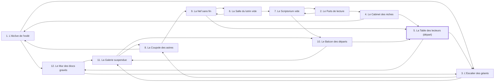

# Le Grand Hall de Céléano

12 lieux tirés (graine : `1926`). Départ : **La Table des lecteurs**.

## Carte des liens



## Tableau des liens

| # | Lieu | Mène à | Mène à |
|---|---|---|---|
| 1 | L'Alcôve de l'exilé | 12. Le Mur des blocs gravés | 3. L'Escalier des géants |
| 2 | Le Puits de lecture | 7. Le Scriptorium vide | 4. Le Cabinet des niches |
| 3 | L'Escalier des géants | 8. La Coupole des astres | 11. La Galerie suspendue |
| 4 | Le Cabinet des niches | 5. La Table des lecteurs | 1. L'Alcôve de l'exilé |
| 5 | La Table des lecteurs (départ) | 3. L'Escalier des géants | 12. Le Mur des blocs gravés |
| 6 | La Salle du lutrin vide | 9. La Nef sans fin | 7. Le Scriptorium vide |
| 7 | Le Scriptorium vide | 10. Le Balcon des départs | 2. Le Puits de lecture |
| 8 | La Coupole des astres | 1. L'Alcôve de l'exilé | 9. La Nef sans fin |
| 9 | La Nef sans fin | 5. La Table des lecteurs | 6. La Salle du lutrin vide |
| 10 | Le Balcon des départs | 11. La Galerie suspendue | 5. La Table des lecteurs |
| 11 | La Galerie suspendue | 8. La Coupole des astres | 10. Le Balcon des départs |
| 12 | Le Mur des blocs gravés | 11. La Galerie suspendue | 3. L'Escalier des géants |

## Lieux

### 1. L'Alcôve de l'exilé

Mène à : 12. Le Mur des blocs gravés · 3. L'Escalier des géants

```text
Illustre une petite alcôve à taille humaine creusée dans la base d'un bloc de granit gigantesque, où un exilé venu ici en esprit s'est autrefois abrité. L'alcôve est vide : une banquette taillée dans la pierre, et sur le rebord un cercle doré terni, là où reposait une coupe d'hydromel. Derrière l'alcôve, le pied d'une colonne colossale s'élève dans l'ombre verte. Silence d'une bibliothèque immense, abandonnée et entièrement vidée : plus aucun livre, tablette, rouleau ni objet, il ne reste que l'architecture de granit, la poussière immobile et les traces de ce qui a disparu. Aucun personnage ni créature. Tout est taillé pour des êtres bien plus grands que l'homme : rends chaque surface et chaque ombre crédible pour que l'étrangeté vienne de l'échelle et du vide. Peinture numérique réaliste à la texture de gouache, bleu profond, bronze patiné et vert pâle. Paysage 16:9, 1536 × 864 px, scène unique plein cadre, sans texte, lettres, bordure, signature ni filigrane.
```

### 2. Le Puits de lecture

Mène à : 7. Le Scriptorium vide · 4. Le Cabinet des niches

```text
Illustre un puits circulaire immense, dont les parois sont tapissées de rayonnages vides qui descendent en anneaux vers une profondeur verte. Une rampe de pierre s'enroule le long des parois. Au premier plan, sur la balustrade de bronze patiné, une poulie à taille humaine reste scellée, sans corde. Silence d'une bibliothèque immense, abandonnée et entièrement vidée : plus aucun livre, tablette, rouleau ni objet, il ne reste que l'architecture de granit, la poussière immobile et les traces de ce qui a disparu. Aucun personnage ni créature. Tout est taillé pour des êtres bien plus grands que l'homme : rends chaque surface et chaque ombre crédible pour que l'étrangeté vienne de l'échelle et du vide. Peinture numérique réaliste à la texture de gouache, bleu profond, bronze patiné et vert pâle. Paysage 16:9, 1536 × 864 px, scène unique plein cadre, sans texte, lettres, bordure, signature ni filigrane.
```

### 3. L'Escalier des géants

Mène à : 8. La Coupole des astres · 11. La Galerie suspendue

```text
Illustre un escalier de granit bleu dont chaque marche est plus haute qu'un homme, descendant en spirale vers une profondeur baignée de vert pâle. Un anneau de bronze scellé dans une marche, de la taille d'une main humaine, ne retient plus aucune corde. Les gravures des contremarches sont usées en reliefs abstraits. Silence d'une bibliothèque immense, abandonnée et entièrement vidée : plus aucun livre, tablette, rouleau ni objet, il ne reste que l'architecture de granit, la poussière immobile et les traces de ce qui a disparu. Aucun personnage ni créature. Tout est taillé pour des êtres bien plus grands que l'homme : rends chaque surface et chaque ombre crédible pour que l'étrangeté vienne de l'échelle et du vide. Peinture numérique réaliste à la texture de gouache, bleu profond, bronze patiné et vert pâle. Paysage 16:9, 1536 × 864 px, scène unique plein cadre, sans texte, lettres, bordure, signature ni filigrane.
```

### 4. Le Cabinet des niches

Mène à : 5. La Table des lecteurs · 1. L'Alcôve de l'exilé

```text
Illustre une paroi de granit creusée de niches immenses, toutes vides, dont les formes rondes, carrées ou en berceau laissent deviner des archives qui n'étaient pas des livres : cylindres, plaques, sphères. Au fond de certaines, une marque circulaire plus claire montre où quelque chose a reposé. Au bas de la paroi, une petite niche à taille humaine est vide elle aussi. Une lumière verte naît au fond de la plus haute niche, sans qu'on en voie l'origine. Silence d'une bibliothèque immense, abandonnée et entièrement vidée : plus aucun livre, tablette, rouleau ni objet, il ne reste que l'architecture de granit, la poussière immobile et les traces de ce qui a disparu. Aucun personnage ni créature. Tout est taillé pour des êtres bien plus grands que l'homme : rends chaque surface et chaque ombre crédible pour que l'étrangeté vienne de l'échelle et du vide. Peinture numérique réaliste à la texture de gouache, bleu profond, bronze patiné et vert pâle. Paysage 16:9, 1536 × 864 px, scène unique plein cadre, sans texte, lettres, bordure, signature ni filigrane.
```

### 5. La Table des lecteurs (départ)

Mène à : 3. L'Escalier des géants · 12. Le Mur des blocs gravés

```text
Illustre une table de granit sculpté dont le plateau domine la scène comme une falaise, entièrement nu. Sur la pierre, des rectangles plus clairs marquent l'emplacement des livres gigantesques qu'on y ouvrait autrefois. Le long d'un des pieds massifs, une rangée d'encoches taillées à la main, chacune à la mesure d'un pied humain, grimpe vers le plateau sans l'atteindre. Une pâle lueur verte éclaire le dessous du plateau. Silence d'une bibliothèque immense, abandonnée et entièrement vidée : plus aucun livre, tablette, rouleau ni objet, il ne reste que l'architecture de granit, la poussière immobile et les traces de ce qui a disparu. Aucun personnage ni créature. Tout est taillé pour des êtres bien plus grands que l'homme : rends chaque surface et chaque ombre crédible pour que l'étrangeté vienne de l'échelle et du vide. Peinture numérique réaliste à la texture de gouache, bleu profond, bronze patiné et vert pâle. Paysage 16:9, 1536 × 864 px, scène unique plein cadre, sans texte, lettres, bordure, signature ni filigrane.
```

### 6. La Salle du lutrin vide

Mène à : 9. La Nef sans fin · 7. Le Scriptorium vide

```text
Illustre le Grand Hall de Céléano, une bibliothèque d'outre-monde abandonnée aux piliers de pierre bleue et aux galeries superposées. Au premier plan, un lutrin de bronze colossal ne porte plus rien : sur son plateau incliné, la poussière garde le rectangle net d'un grand livre disparu. Une lumière verte se répand sur le sol depuis le bas du lutrin. Derrière, les galeries et les rayonnages vides se fondent progressivement dans l'obscurité des voûtes. Silence d'une bibliothèque immense, abandonnée et entièrement vidée : plus aucun livre, tablette, rouleau ni objet, il ne reste que l'architecture de granit, la poussière immobile et les traces de ce qui a disparu. Aucun personnage ni créature. Tout est taillé pour des êtres bien plus grands que l'homme : rends chaque surface et chaque ombre crédible pour que l'étrangeté vienne de l'échelle et du vide. Peinture numérique réaliste à la texture de gouache, bleu profond, bronze patiné et vert pâle. Paysage 16:9, 1536 × 864 px, scène unique plein cadre, sans texte, lettres, bordure, signature ni filigrane.
```

### 7. Le Scriptorium vide

Mène à : 10. Le Balcon des départs · 2. Le Puits de lecture

```text
Illustre un pupitre d'écriture de granit aussi haut qu'une maison, entièrement nu. Un encrier creusé dans la pierre, large comme une citerne, est sec, avec un cerne noir au fond. Au pied du pupitre, un marchepied taillé à taille humaine ne mène nulle part. Une lumière verte effleure le bord de l'encrier sans qu'on en voie l'origine. Silence d'une bibliothèque immense, abandonnée et entièrement vidée : plus aucun livre, tablette, rouleau ni objet, il ne reste que l'architecture de granit, la poussière immobile et les traces de ce qui a disparu. Aucun personnage ni créature. Tout est taillé pour des êtres bien plus grands que l'homme : rends chaque surface et chaque ombre crédible pour que l'étrangeté vienne de l'échelle et du vide. Peinture numérique réaliste à la texture de gouache, bleu profond, bronze patiné et vert pâle. Paysage 16:9, 1536 × 864 px, scène unique plein cadre, sans texte, lettres, bordure, signature ni filigrane.
```

### 8. La Coupole des astres

Mène à : 1. L'Alcôve de l'exilé · 9. La Nef sans fin

```text
Illustre une coupole de granit sculpté où des clous de bronze figurent des constellations inconnues, sans aucun signe ni lettre. Au centre, une table colossale est nue ; une empreinte circulaire au milieu du plateau trahit l'instrument disparu. Un escalier à taille humaine, taillé dans le pied de la table, donne l'échelle. Une lumière verte descend de l'oculus de la coupole sans qu'on en voie la source. Silence d'une bibliothèque immense, abandonnée et entièrement vidée : plus aucun livre, tablette, rouleau ni objet, il ne reste que l'architecture de granit, la poussière immobile et les traces de ce qui a disparu. Aucun personnage ni créature. Tout est taillé pour des êtres bien plus grands que l'homme : rends chaque surface et chaque ombre crédible pour que l'étrangeté vienne de l'échelle et du vide. Peinture numérique réaliste à la texture de gouache, bleu profond, bronze patiné et vert pâle. Paysage 16:9, 1536 × 864 px, scène unique plein cadre, sans texte, lettres, bordure, signature ni filigrane.
```

### 9. La Nef sans fin

Mène à : 5. La Table des lecteurs · 6. La Salle du lutrin vide

```text
Illustre une nef dont les rangées de colonnes de granit bleu s'alignent jusqu'à se perdre dans l'obscurité, sans qu'on en voie le fond. Le sol est nu, sans un meuble. À la base de la colonne la plus proche, une niche à taille humaine, vide, donne l'échelle. Des bandes de lumière verte tombent de très haut entre les colonnes, sans source visible. Silence d'une bibliothèque immense, abandonnée et entièrement vidée : plus aucun livre, tablette, rouleau ni objet, il ne reste que l'architecture de granit, la poussière immobile et les traces de ce qui a disparu. Aucun personnage ni créature. Tout est taillé pour des êtres bien plus grands que l'homme : rends chaque surface et chaque ombre crédible pour que l'étrangeté vienne de l'échelle et du vide. Peinture numérique réaliste à la texture de gouache, bleu profond, bronze patiné et vert pâle. Paysage 16:9, 1536 × 864 px, scène unique plein cadre, sans texte, lettres, bordure, signature ni filigrane.
```

### 10. Le Balcon des départs

Mène à : 11. La Galerie suspendue · 5. La Table des lecteurs

```text
Illustre une immense ouverture taillée dans le mur du Grand Hall, donnant sur un ciel nocturne immobile où brillent des étoiles inconnues. La corniche de granit, large comme une place, est entièrement nue ; seul un étroit escalier à taille humaine y mène, là où des exilés attendaient d'être emportés. Une lueur verte venue de l'intérieur du hall rase le seuil. Silence d'une bibliothèque immense, abandonnée et entièrement vidée : plus aucun livre, tablette, rouleau ni objet, il ne reste que l'architecture de granit, la poussière immobile et les traces de ce qui a disparu. Aucun personnage ni créature. Tout est taillé pour des êtres bien plus grands que l'homme : rends chaque surface et chaque ombre crédible pour que l'étrangeté vienne de l'échelle et du vide. Peinture numérique réaliste à la texture de gouache, bleu profond, bronze patiné et vert pâle. Paysage 16:9, 1536 × 864 px, scène unique plein cadre, sans texte, lettres, bordure, signature ni filigrane.
```

### 11. La Galerie suspendue

Mène à : 8. La Coupole des astres · 10. Le Balcon des départs

```text
Illustre une passerelle de pierre sans garde-fou, jetée entre deux falaises de rayonnages vides au-dessus d'un gouffre d'ombre. Sur son flanc, un étroit escalier à taille humaine taillé dans la pierre descend vers le vide. Une lumière verte monte d'en bas et dessine les rayons nus. Silence d'une bibliothèque immense, abandonnée et entièrement vidée : plus aucun livre, tablette, rouleau ni objet, il ne reste que l'architecture de granit, la poussière immobile et les traces de ce qui a disparu. Aucun personnage ni créature. Tout est taillé pour des êtres bien plus grands que l'homme : rends chaque surface et chaque ombre crédible pour que l'étrangeté vienne de l'échelle et du vide. Peinture numérique réaliste à la texture de gouache, bleu profond, bronze patiné et vert pâle. Paysage 16:9, 1536 × 864 px, scène unique plein cadre, sans texte, lettres, bordure, signature ni filigrane.
```

### 12. Le Mur des blocs gravés

Mène à : 11. La Galerie suspendue · 3. L'Escalier des géants

```text
Illustre un mur colossal fait de rangées de blocs de granit bleu empilés, chacun bombé sur le dessus et creusé en dessous, si bien que leurs bords forment des corniches d'ombre superposées. Leurs faces sont couvertes de gravures usées jusqu'à n'être plus que des reliefs abstraits, et les corniches sont vides. Au pied du mur, une porte basse à taille humaine, percée dans un seul bloc, s'ouvre sur le noir. Une lumière verte glisse le long du mur depuis une source hors du cadre. Silence d'une bibliothèque immense, abandonnée et entièrement vidée : plus aucun livre, tablette, rouleau ni objet, il ne reste que l'architecture de granit, la poussière immobile et les traces de ce qui a disparu. Aucun personnage ni créature. Tout est taillé pour des êtres bien plus grands que l'homme : rends chaque surface et chaque ombre crédible pour que l'étrangeté vienne de l'échelle et du vide. Peinture numérique réaliste à la texture de gouache, bleu profond, bronze patiné et vert pâle. Paysage 16:9, 1536 × 864 px, scène unique plein cadre, sans texte, lettres, bordure, signature ni filigrane.
```
