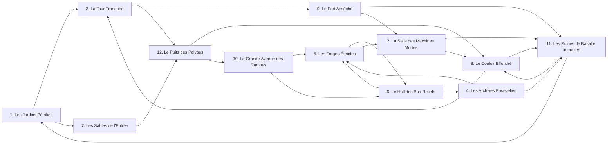

# La Cité de Yith : lieux et progression

## Carte des liens



## Tableau des liens

| # | Lieu | Mène à | Mène à |
|---|------|--------|--------|
| 1 | Les Jardins Pétrifiés | 3. La Tour Tronquée | 7. Les Sables de l'Entrée |
| 2 | La Salle des Machines Mortes | 11. Les Ruines de Basalte Interdites | 8. Le Couloir Effondré |
| 3 | La Tour Tronquée | 12. Le Puits des Polypes | 9. Le Port Asséché |
| 4 | Les Archives Ensevelies | 5. Les Forges Éteintes | 11. Les Ruines de Basalte Interdites |
| 5 | Les Forges Éteintes | 6. Le Hall des Bas-Reliefs | 2. La Salle des Machines Mortes |
| 6 | Le Hall des Bas-Reliefs | 4. Les Archives Ensevelies | 5. Les Forges Éteintes |
| 7 | Les Sables de l'Entrée | 12. Le Puits des Polypes | 12. Le Puits des Polypes |
| 8 | Le Couloir Effondré | 11. Les Ruines de Basalte Interdites | 3. La Tour Tronquée |
| 9 | Le Port Asséché | 11. Les Ruines de Basalte Interdites | 2. La Salle des Machines Mortes |
| 10 | La Grande Avenue des Rampes | 5. Les Forges Éteintes | 6. Le Hall des Bas-Reliefs |
| 11 | Les Ruines de Basalte Interdites | 8. Le Couloir Effondré | 1. Les Jardins Pétrifiés |
| 12 | Le Puits des Polypes | 8. Le Couloir Effondré | 10. La Grande Avenue des Rampes |

## Lieux et prompts

### 1. Les Jardins Pétrifiés (départ)

Mène à : **3. La Tour Tronquée** et **7. Les Sables de l'Entrée**

```
Ruines millénaires abandonnées, à demi ensevelies dans le désert australien aride, de nos jours. Aucun personnage, aucune créature, aucune trace d'eau ; seulement de la pierre érodée, du sable et des objets brisés. Terrasses en surplomb couvertes de sable, où ne restent que des troncs de fougères géantes fossilisés et des empreintes de plantes dans la pierre. Des balustrades massives effondrées dominent un désert sans fin. Peinture numérique réaliste à la texture de gouache, ocre doré, ombres olive et bronze oxydé. Paysage 16:9, 1536 × 864 px, scène unique plein cadre, sans inscriptions, bordure, signature ni filigrane.
```

### 2. La Salle des Machines Mortes

Mène à : **11. Les Ruines de Basalte Interdites** et **8. Le Couloir Effondré**

```
Ruines millénaires abandonnées, à demi ensevelies dans le désert australien aride, de nos jours. Aucun personnage, aucune créature, aucune trace d'eau ; seulement de la pierre érodée, du sable et des objets brisés. Vaste salle voûtée à moitié remplie de sable, des machines étranges de métal corrodé et de cristal fêlé, démantelées et figées dans des alcôves vides, éclairées par une lumière pâle venue d'en haut. Peinture numérique réaliste à la texture de gouache, ocre doré, ombres olive et bronze oxydé. Paysage 16:9, 1536 × 864 px, scène unique plein cadre, sans inscriptions, bordure, signature ni filigrane.
```

### 3. La Tour Tronquée

Mène à : **12. Le Puits des Polypes** et **9. Le Port Asséché**

```
Ruines millénaires abandonnées, à demi ensevelies dans le désert australien aride, de nos jours. Aucun personnage, aucune créature, aucune trace d'eau ; seulement de la pierre érodée, du sable et des objets brisés. Sommet décapité d'une tour titanesque aux fenêtres voûtées béantes, des instruments astronomiques inconnus tordus et brisés, une vue sur des ruines noyées de dunes au crépuscule. Peinture numérique réaliste à la texture de gouache, ocre doré, ombres olive et bronze oxydé. Paysage 16:9, 1536 × 864 px, scène unique plein cadre, sans inscriptions, bordure, signature ni filigrane.
```

### 4. Les Archives Ensevelies

Mène à : **5. Les Forges Éteintes** et **11. Les Ruines de Basalte Interdites**

```
Ruines millénaires abandonnées, à demi ensevelies dans le désert australien aride, de nos jours. Aucun personnage, aucune créature, aucune trace d'eau ; seulement de la pierre érodée, du sable et des objets brisés. Bibliothèque souterraine immense et silencieuse. Des étagères rectilignes renversées, des étuis de métal grisâtre cabossés et ouverts jonchent le sol, la poussière flotte dans un rai de lumière tombé d'une fissure. Peinture numérique réaliste à la texture de gouache, ocre doré, ombres olive et bronze oxydé. Paysage 16:9, 1536 × 864 px, scène unique plein cadre, sans inscriptions, bordure, signature ni filigrane.
```

### 5. Les Forges Éteintes

Mène à : **6. Le Hall des Bas-Reliefs** et **2. La Salle des Machines Mortes**

```
Ruines millénaires abandonnées, à demi ensevelies dans le désert australien aride, de nos jours. Aucun personnage, aucune créature, aucune trace d'eau ; seulement de la pierre érodée, du sable et des objets brisés. Atelier souterrain où d'énormes mécanismes de métal oxydé et de cristal terne sont éventrés, des carcasses de véhicules aux formes étranges démontées, du sable accumulé contre les parois. Peinture numérique réaliste à la texture de gouache, ocre doré, ombres olive et bronze oxydé. Paysage 16:9, 1536 × 864 px, scène unique plein cadre, sans inscriptions, bordure, signature ni filigrane.
```

### 6. Le Hall des Bas-Reliefs

Mène à : **4. Les Archives Ensevelies** et **5. Les Forges Éteintes**

```
Ruines millénaires abandonnées, à demi ensevelies dans le désert australien aride, de nos jours. Aucun personnage, aucune créature, aucune trace d'eau ; seulement de la pierre érodée, du sable et des objets brisés. Galerie monumentale aux colonnes renversées, des murs ornés de larges bandes de motifs curvilignes abstraits, érodés et écaillés, des rayons de lumière poussiéreux à travers la voûte crevée. Peinture numérique réaliste à la texture de gouache, ocre doré, ombres olive et bronze oxydé. Paysage 16:9, 1536 × 864 px, scène unique plein cadre, sans inscriptions, bordure, signature ni filigrane.
```

### 7. Les Sables de l'Entrée

Mène à : **12. Le Puits des Polypes**

```
Ruines millénaires abandonnées, à demi ensevelies dans le désert australien aride, de nos jours. Aucun personnage, aucune créature, aucune trace d'eau ; seulement de la pierre érodée, du sable et des objets brisés. Sous un ciel étoilé immense, des blocs cyclopéens sculptés et fendus émergent à peine des dunes de sable rouge. Une ouverture sombre s'enfonce sous la terre entre deux dalles basculées. Peinture numérique réaliste à la texture de gouache, ocre doré, ombres olive et bronze oxydé. Paysage 16:9, 1536 × 864 px, scène unique plein cadre, sans inscriptions, bordure, signature ni filigrane.
```

### 8. Le Couloir Effondré

Mène à : **11. Les Ruines de Basalte Interdites** et **3. La Tour Tronquée**

```
Ruines millénaires abandonnées, à demi ensevelies dans le désert australien aride, de nos jours. Aucun personnage, aucune créature, aucune trace d'eau ; seulement de la pierre érodée, du sable et des objets brisés. Galerie souterraine écroulée, des blocs cyclopéens fendus, du sable qui s'infiltre en cascades sèches par les fissures, une étroite clarté au fond du passage. Peinture numérique réaliste à la texture de gouache, ocre doré, ombres olive et bronze oxydé. Paysage 16:9, 1536 × 864 px, scène unique plein cadre, sans inscriptions, bordure, signature ni filigrane.
```

### 9. Le Port Asséché

Mène à : **11. Les Ruines de Basalte Interdites** et **2. La Salle des Machines Mortes**

```
Ruines millénaires abandonnées, à demi ensevelies dans le désert australien aride, de nos jours. Aucun personnage, aucune créature, aucune trace d'eau ; seulement de la pierre érodée, du sable et des objets brisés. Quais de pierre cyclopéens dominant une ancienne mer devenue plaine de sel craquelé et de sable, des carcasses d'embarcations aux formes non humaines réduites à des armatures de métal rongé. Peinture numérique réaliste à la texture de gouache, ocre doré, ombres olive et bronze oxydé. Paysage 16:9, 1536 × 864 px, scène unique plein cadre, sans inscriptions, bordure, signature ni filigrane.
```

### 10. La Grande Avenue des Rampes

Mène à : **5. Les Forges Éteintes** et **6. Le Hall des Bas-Reliefs**

```
Ruines millénaires abandonnées, à demi ensevelies dans le désert australien aride, de nos jours. Aucun personnage, aucune créature, aucune trace d'eau ; seulement de la pierre érodée, du sable et des objets brisés. Avenue colossale comblée de sable, bordée de tours de basalte écroulées aux toits convexes éventrés. De larges rampes inclinées, brisées, mènent vers des niveaux disparus, sous un soleil écrasant. Peinture numérique réaliste à la texture de gouache, ocre doré, ombres olive et bronze oxydé. Paysage 16:9, 1536 × 864 px, scène unique plein cadre, sans inscriptions, bordure, signature ni filigrane.
```

### 11. Les Ruines de Basalte Interdites

Mène à : **8. Le Couloir Effondré** et **1. Les Jardins Pétrifiés**

```
Ruines millénaires abandonnées, à demi ensevelies dans le désert australien aride, de nos jours. Aucun personnage, aucune créature, aucune trace d'eau ; seulement de la pierre érodée, du sable et des objets brisés. Édifice de basalte noir sans fenêtres, plus ancien que la cité, une trappe massive scellée au sol, fissurée, du sable qui s'écoule dans ses fentes, une impression de menace venue d'en dessous. Peinture numérique réaliste à la texture de gouache, ocre doré, ombres olive et bronze oxydé. Paysage 16:9, 1536 × 864 px, scène unique plein cadre, sans inscriptions, bordure, signature ni filigrane.
```

### 12. Le Puits des Polypes

Mène à : **8. Le Couloir Effondré** et **10. La Grande Avenue des Rampes**

```
Ruines millénaires abandonnées, à demi ensevelies dans le désert australien aride, de nos jours. Aucun personnage, aucune créature, aucune trace d'eau ; seulement de la pierre érodée, du sable et des objets brisés. Gouffre vertical aux parois de pierre lisse, des débris et des blocs effondrés suspendus au bord, des tourbillons de poussière, une lumière qui faiblit vers des profondeurs insondables. Peinture numérique réaliste à la texture de gouache, ocre doré, ombres olive et bronze oxydé. Paysage 16:9, 1536 × 864 px, scène unique plein cadre, sans inscriptions, bordure, signature ni filigrane.
```
