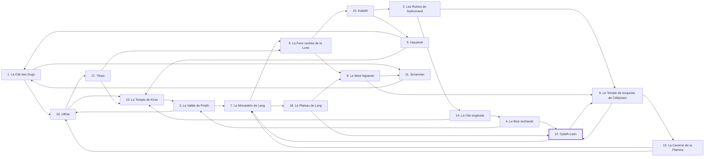

# Lieux — Contrées du Rêve

Graine : `2136438542` · Lieux : 18 · Départ : **Dylath-Leen**

## Carte des liens



## Tableau des liens

| # | Lieu | Mène à | Mène à |
|---|------|--------|--------|
| 1 | La Cité des Gugs | Ulthar | Serannian |
| 2 | Les Ruines de Sarkomand | La Cité engloutie | Le Temple de turquoise de Céléphaïs |
| 3 | La Vallée de Pnath | Ulthar | Le Monastère de Leng |
| 4 | Le Bois enchanté | Dylath-Leen | La Vallée de Pnath |
| 5 | Inquanok | La Cité des Gugs | Le Temple de Kiran |
| 6 | Le Temple de turquoise de Céléphaïs | La Caverne de la Flamme | Dylath-Leen |
| 7 | Le Monastère de Leng | Le Plateau de Leng | La Face cachée de la Lune |
| 8 | Le Mont Ngranek | Le Temple de turquoise de Céléphaïs | Serannian |
| 9 | La Face cachée de la Lune | Kadath | Le Mont Ngranek |
| 10 | Kadath | Les Ruines de Sarkomand | Inquanok |
| 11 | Serannian | La Cité des Gugs | La Cité des Gugs |
| 12 | **Dylath-Leen** (départ) | Le Monastère de Leng | Le Temple de turquoise de Céléphaïs |
| 13 | La Caverne de la Flamme | Le Monastère de Leng | Ulthar |
| 14 | La Cité engloutie | Le Temple de Kiran | Le Bois enchanté |
| 15 | Le Temple de Kiran | La Vallée de Pnath | La Vallée de Pnath |
| 16 | Ulthar | Le Temple de Kiran | Thran |
| 17 | Thran | Le Temple de Kiran | La Face cachée de la Lune |
| 18 | Le Plateau de Leng | Dylath-Leen | Le Mont Ngranek |

## Prompts

### 1. La Cité des Gugs

Mène à : Ulthar, Serannian

```
Illustre la cité souterraine des Gugs, une forêt de tours rondes cyclopéennes qui montent dans une pénombre bleutée jusqu'à se perdre sous une voûte invisible. Au centre se dresse la tour de Koth, dont l'escalier extérieur est fait de marches gigantesques, chacune haute comme un mur. Dans l'angle d'une marche, une rangée d'encoches minuscules a été taillée bien plus tard, à la mesure d'un pied humain, pour permettre de l'escalader. Les portes des tours sont des arches démesurées, et le sol de pierre est couvert de lichens grisâtres. Le décor appartient aux Contrées du Rêve décrites par H. P. Lovecraft, un monde ancien où l'on n'entre qu'en rêvant, à la fois splendide et menaçant, où chaque cité semble avoir toujours existé. L'étrangeté naît de l'échelle, de la géométrie et de l'ambiance, jamais de matières fantaisistes : pierre, marbre, onyx, eau, feuillage et pelage restent crédibles. L'échelle se lit grâce à un élément d'architecture à taille humaine. Aucun personnage humain. Les gravures et les reliefs sont usés jusqu'à n'être plus que des formes abstraites, sans aucune lettre, aucun symbole ni hiéroglyphe lisible. Peinture numérique réaliste à la texture de gouache, palette de bleus lapis profonds, de violets crépusculaires, de noirs d'onyx et d'ors pâles, rehaussée de touches de jade et de rose nacré, lumière dorée et opaline de crépuscule onirique, diffuse et sans source visible. Paysage 16:9, 1536 × 864 px, scène unique plein cadre, sans texte ni lettres dans le décor, sans bordure, signature ni filigrane.
```

### 2. Les Ruines de Sarkomand

Mène à : La Cité engloutie, Le Temple de turquoise de Céléphaïs

```
Illustre les ruines de Sarkomand, cité morte d'une race oubliée, aux colonnes brisées et aux murs effondrés envahis de mousse sombre. Au centre d'une grande place s'ouvre un escalier qui plonge sous terre, gardé par deux immenses lions ailés de diorite assis face à face. L'escalier commence par des marches à taille humaine, polies et fendues, qui disparaissent dans le noir. Des herbes sèches poussent entre les dalles, et les reliefs des socles sont effacés par l'érosion. Le décor appartient aux Contrées du Rêve décrites par H. P. Lovecraft, un monde ancien où l'on n'entre qu'en rêvant, à la fois splendide et menaçant, où chaque cité semble avoir toujours existé. L'étrangeté naît de l'échelle, de la géométrie et de l'ambiance, jamais de matières fantaisistes : pierre, marbre, onyx, eau, feuillage et pelage restent crédibles. L'échelle se lit grâce à un élément d'architecture à taille humaine. Aucun personnage humain. Les gravures et les reliefs sont usés jusqu'à n'être plus que des formes abstraites, sans aucune lettre, aucun symbole ni hiéroglyphe lisible. Peinture numérique réaliste à la texture de gouache, palette de bleus lapis profonds, de violets crépusculaires, de noirs d'onyx et d'ors pâles, rehaussée de touches de jade et de rose nacré, lumière dorée et opaline de crépuscule onirique, diffuse et sans source visible. Paysage 16:9, 1536 × 864 px, scène unique plein cadre, sans texte ni lettres dans le décor, sans bordure, signature ni filigrane.
```

### 3. La Vallée de Pnath

Mène à : Ulthar, Le Monastère de Leng

```
Illustre la vallée de Pnath, un gouffre sans fond apparent au cœur du monde inférieur, où la lumière ne parvient qu'à peine. Le sol est fait d'ossements très anciens, blanchis et polis par le temps, entassés en collines et en dunes comme des sédiments. Contre la paroi de basalte, une niche taillée, juste assez grande pour qu'un homme s'y abrite assis, domine l'amoncellement. De longues coulées d'eau suintent le long de la roche noire. Le décor appartient aux Contrées du Rêve décrites par H. P. Lovecraft, un monde ancien où l'on n'entre qu'en rêvant, à la fois splendide et menaçant, où chaque cité semble avoir toujours existé. L'étrangeté naît de l'échelle, de la géométrie et de l'ambiance, jamais de matières fantaisistes : pierre, marbre, onyx, eau, feuillage et pelage restent crédibles. L'échelle se lit grâce à un élément d'architecture à taille humaine. Aucun personnage humain. Les gravures et les reliefs sont usés jusqu'à n'être plus que des formes abstraites, sans aucune lettre, aucun symbole ni hiéroglyphe lisible. Peinture numérique réaliste à la texture de gouache, palette de bleus lapis profonds, de violets crépusculaires, de noirs d'onyx et d'ors pâles, rehaussée de touches de jade et de rose nacré, lumière dorée et opaline de crépuscule onirique, diffuse et sans source visible. Paysage 16:9, 1536 × 864 px, scène unique plein cadre, sans texte ni lettres dans le décor, sans bordure, signature ni filigrane.
```

### 4. Le Bois enchanté

Mène à : Dylath-Leen, La Vallée de Pnath

```
Illustre le Bois enchanté qui borde la frontière du rêve, une forêt de chênes énormes aux troncs couverts de lichens faiblement luminescents. Leurs racines soulèvent d'anciennes dalles moussues et enserrent un cercle de pierres levées à demi englouties. Au pied d'un tronc s'ouvre un passage voûté en pierres sèches, à peine assez haut pour qu'un homme s'y glisse en se baissant. Des champignons pâles luisent dans les creux, et de minuscules yeux brillent entre les racines sans que l'on distingue de corps. Le décor appartient aux Contrées du Rêve décrites par H. P. Lovecraft, un monde ancien où l'on n'entre qu'en rêvant, à la fois splendide et menaçant, où chaque cité semble avoir toujours existé. L'étrangeté naît de l'échelle, de la géométrie et de l'ambiance, jamais de matières fantaisistes : pierre, marbre, onyx, eau, feuillage et pelage restent crédibles. L'échelle se lit grâce à un élément d'architecture à taille humaine. Aucun personnage humain. Les gravures et les reliefs sont usés jusqu'à n'être plus que des formes abstraites, sans aucune lettre, aucun symbole ni hiéroglyphe lisible. Peinture numérique réaliste à la texture de gouache, palette de bleus lapis profonds, de violets crépusculaires, de noirs d'onyx et d'ors pâles, rehaussée de touches de jade et de rose nacré, lumière dorée et opaline de crépuscule onirique, diffuse et sans source visible. Paysage 16:9, 1536 × 864 px, scène unique plein cadre, sans texte ni lettres dans le décor, sans bordure, signature ni filigrane.
```

### 5. Inquanok

Mène à : La Cité des Gugs, Le Temple de Kiran

```
Illustre Inquanok, la cité d'onyx du pays crépusculaire, aux murs, dômes et minarets taillés dans une pierre noire et lustrée, veinée d'or. Au centre s'élève un grand temple à nombreux côtés coiffé d'un dôme, entouré d'une place circulaire pavée d'onyx. Une large rue dallée y mène, bordée de maisons aveugles dont chaque porte basse est surmontée d'un linteau aux motifs érodés. Des fontaines sèches s'adossent aux murs. Le crépuscule ne finit jamais au-dessus des toits. Le décor appartient aux Contrées du Rêve décrites par H. P. Lovecraft, un monde ancien où l'on n'entre qu'en rêvant, à la fois splendide et menaçant, où chaque cité semble avoir toujours existé. L'étrangeté naît de l'échelle, de la géométrie et de l'ambiance, jamais de matières fantaisistes : pierre, marbre, onyx, eau, feuillage et pelage restent crédibles. L'échelle se lit grâce à un élément d'architecture à taille humaine. Aucun personnage humain. Les gravures et les reliefs sont usés jusqu'à n'être plus que des formes abstraites, sans aucune lettre, aucun symbole ni hiéroglyphe lisible. Peinture numérique réaliste à la texture de gouache, palette de bleus lapis profonds, de violets crépusculaires, de noirs d'onyx et d'ors pâles, rehaussée de touches de jade et de rose nacré, lumière dorée et opaline de crépuscule onirique, diffuse et sans source visible. Paysage 16:9, 1536 × 864 px, scène unique plein cadre, sans texte ni lettres dans le décor, sans bordure, signature ni filigrane.
```

### 6. Le Temple de turquoise de Céléphaïs

Mène à : La Caverne de la Flamme, Dylath-Leen

```
Illustre l'intérieur du temple de turquoise de Nath-Horthath, à Céléphaïs, une salle circulaire aux murs entièrement revêtus de turquoise polie. Au centre, une vasque d'eau parfaitement immobile reflète une coupole percée d'oculi par où tombe une lueur douce. Le long des murs, une rangée de niches basses, chacune assez large pour un homme assis, abrite des coussins de soie pâlie. Le dallage de marbre veiné est jonché d'orchidées fraîches. Les chapiteaux ne portent plus que des volutes floues, effacées par le temps. Le décor appartient aux Contrées du Rêve décrites par H. P. Lovecraft, un monde ancien où l'on n'entre qu'en rêvant, à la fois splendide et menaçant, où chaque cité semble avoir toujours existé. L'étrangeté naît de l'échelle, de la géométrie et de l'ambiance, jamais de matières fantaisistes : pierre, marbre, onyx, eau, feuillage et pelage restent crédibles. L'échelle se lit grâce à un élément d'architecture à taille humaine. Aucun personnage humain. Les gravures et les reliefs sont usés jusqu'à n'être plus que des formes abstraites, sans aucune lettre, aucun symbole ni hiéroglyphe lisible. Peinture numérique réaliste à la texture de gouache, palette de bleus lapis profonds, de violets crépusculaires, de noirs d'onyx et d'ors pâles, rehaussée de touches de jade et de rose nacré, lumière dorée et opaline de crépuscule onirique, diffuse et sans source visible. Paysage 16:9, 1536 × 864 px, scène unique plein cadre, sans texte ni lettres dans le décor, sans bordure, signature ni filigrane.
```

### 7. Le Monastère de Leng

Mène à : Le Plateau de Leng, La Face cachée de la Lune

```
Illustre l'intérieur du monastère préhistorique et sans fenêtres de Leng, un dédale de couloirs de pierre grise aux plafonds bas. Sur les murs courent des fresques si anciennes et si écaillées qu'il n'en reste que des taches de pigment et des reliefs abstraits. Le couloir débouche sur une salle en dôme, au centre de laquelle s'ouvre un puits rond entouré d'une margelle à hauteur de genou. Une porte basse et étroite, sous une arche massive, ouvre sur une obscurité plus profonde. L'air semble immobile depuis des millénaires. Le décor appartient aux Contrées du Rêve décrites par H. P. Lovecraft, un monde ancien où l'on n'entre qu'en rêvant, à la fois splendide et menaçant, où chaque cité semble avoir toujours existé. L'étrangeté naît de l'échelle, de la géométrie et de l'ambiance, jamais de matières fantaisistes : pierre, marbre, onyx, eau, feuillage et pelage restent crédibles. L'échelle se lit grâce à un élément d'architecture à taille humaine. Aucun personnage humain. Les gravures et les reliefs sont usés jusqu'à n'être plus que des formes abstraites, sans aucune lettre, aucun symbole ni hiéroglyphe lisible. Peinture numérique réaliste à la texture de gouache, palette de bleus lapis profonds, de violets crépusculaires, de noirs d'onyx et d'ors pâles, rehaussée de touches de jade et de rose nacré, lumière dorée et opaline de crépuscule onirique, diffuse et sans source visible. Paysage 16:9, 1536 × 864 px, scène unique plein cadre, sans texte ni lettres dans le décor, sans bordure, signature ni filigrane.
```

### 8. Le Mont Ngranek

Mène à : Le Temple de turquoise de Céléphaïs, Serannian

```
Illustre le versant caché du mont Ngranek, sur l'île d'Oriab, une immense paroi de lave noire refroidie. Haut dans la roche est sculpté un visage de pierre colossal aux longs yeux étroits, aux oreilles allongées et au nez mince, tourné gravement vers le large. Au premier plan, une corniche étroite longe la falaise, avec des encoches taillées dans la lave pour y poser le pied d'un homme. Des nuages s'accrochent à mi-hauteur, et la mer brille loin en contrebas. Le décor appartient aux Contrées du Rêve décrites par H. P. Lovecraft, un monde ancien où l'on n'entre qu'en rêvant, à la fois splendide et menaçant, où chaque cité semble avoir toujours existé. L'étrangeté naît de l'échelle, de la géométrie et de l'ambiance, jamais de matières fantaisistes : pierre, marbre, onyx, eau, feuillage et pelage restent crédibles. L'échelle se lit grâce à un élément d'architecture à taille humaine. Aucun personnage humain. Les gravures et les reliefs sont usés jusqu'à n'être plus que des formes abstraites, sans aucune lettre, aucun symbole ni hiéroglyphe lisible. Peinture numérique réaliste à la texture de gouache, palette de bleus lapis profonds, de violets crépusculaires, de noirs d'onyx et d'ors pâles, rehaussée de touches de jade et de rose nacré, lumière dorée et opaline de crépuscule onirique, diffuse et sans source visible. Paysage 16:9, 1536 × 864 px, scène unique plein cadre, sans texte ni lettres dans le décor, sans bordure, signature ni filigrane.
```

### 9. La Face cachée de la Lune

Mène à : Kadath, Le Mont Ngranek

```
Illustre la face cachée de la Lune telle que la rêvent les Contrées, un rivage d'eau noire et huileuse bordé de collines grises couvertes de forêts de champignons blanchâtres. Au bord de l'eau s'élève une cité sans fenêtres, faite de tours trapues et grisâtres aux formes vaguement crapaudines. Un quai de pierre grossière descend dans l'eau par des marches inégales, dont la dernière, à taille humaine, est luisante de dépôts. Le ciel est noir et piqué d'étoiles. Rien ne bouge, ni vent ni vague. Le décor appartient aux Contrées du Rêve décrites par H. P. Lovecraft, un monde ancien où l'on n'entre qu'en rêvant, à la fois splendide et menaçant, où chaque cité semble avoir toujours existé. L'étrangeté naît de l'échelle, de la géométrie et de l'ambiance, jamais de matières fantaisistes : pierre, marbre, onyx, eau, feuillage et pelage restent crédibles. L'échelle se lit grâce à un élément d'architecture à taille humaine. Aucun personnage humain. Les gravures et les reliefs sont usés jusqu'à n'être plus que des formes abstraites, sans aucune lettre, aucun symbole ni hiéroglyphe lisible. Peinture numérique réaliste à la texture de gouache, palette de bleus lapis profonds, de violets crépusculaires, de noirs d'onyx et d'ors pâles, rehaussée de touches de jade et de rose nacré, lumière dorée et opaline de crépuscule onirique, diffuse et sans source visible. Paysage 16:9, 1536 × 864 px, scène unique plein cadre, sans texte ni lettres dans le décor, sans bordure, signature ni filigrane.
```

### 10. Kadath

Mène à : Les Ruines de Sarkomand, Inquanok

```
Illustre Kadath, le château d'onyx des Grands Dieux, posé au sommet d'une montagne inconnue qui domine un désert glacé. Ses tours innombrables, d'une taille inhumaine, se découpent contre un ciel étoilé, et ses murs noirs se perdent dans les nuages. Au premier plan, un immense escalier taillé dans la roche et la glace mène à une porte gigantesque, dans laquelle s'ouvre une porte basse à la mesure d'un homme. Les pentes enneigées tombent à pic vers une vallée invisible. Le décor appartient aux Contrées du Rêve décrites par H. P. Lovecraft, un monde ancien où l'on n'entre qu'en rêvant, à la fois splendide et menaçant, où chaque cité semble avoir toujours existé. L'étrangeté naît de l'échelle, de la géométrie et de l'ambiance, jamais de matières fantaisistes : pierre, marbre, onyx, eau, feuillage et pelage restent crédibles. L'échelle se lit grâce à un élément d'architecture à taille humaine. Aucun personnage humain. Les gravures et les reliefs sont usés jusqu'à n'être plus que des formes abstraites, sans aucune lettre, aucun symbole ni hiéroglyphe lisible. Peinture numérique réaliste à la texture de gouache, palette de bleus lapis profonds, de violets crépusculaires, de noirs d'onyx et d'ors pâles, rehaussée de touches de jade et de rose nacré, lumière dorée et opaline de crépuscule onirique, diffuse et sans source visible. Paysage 16:9, 1536 × 864 px, scène unique plein cadre, sans texte ni lettres dans le décor, sans bordure, signature ni filigrane.
```

### 11. Serannian

Mène à : La Cité des Gugs

```
Illustre Serannian, la cité de marbre rose qui flotte parmi les nuages, là où la mer rejoint le ciel. Ses quais bordent un océan de nuages au lieu d'eau, et de hautes tours fines s'élèvent au-dessus de jardins suspendus. Au premier plan, un escalier aux marches basses descend du quai jusque dans le vide nuageux, comme pour accueillir un navire. Un parapet aux motifs usés court le long du quai. Tout baigne dans un éther rose et doré. Le décor appartient aux Contrées du Rêve décrites par H. P. Lovecraft, un monde ancien où l'on n'entre qu'en rêvant, à la fois splendide et menaçant, où chaque cité semble avoir toujours existé. L'étrangeté naît de l'échelle, de la géométrie et de l'ambiance, jamais de matières fantaisistes : pierre, marbre, onyx, eau, feuillage et pelage restent crédibles. L'échelle se lit grâce à un élément d'architecture à taille humaine. Aucun personnage humain. Les gravures et les reliefs sont usés jusqu'à n'être plus que des formes abstraites, sans aucune lettre, aucun symbole ni hiéroglyphe lisible. Peinture numérique réaliste à la texture de gouache, palette de bleus lapis profonds, de violets crépusculaires, de noirs d'onyx et d'ors pâles, rehaussée de touches de jade et de rose nacré, lumière dorée et opaline de crépuscule onirique, diffuse et sans source visible. Paysage 16:9, 1536 × 864 px, scène unique plein cadre, sans texte ni lettres dans le décor, sans bordure, signature ni filigrane.
```

### 12. Dylath-Leen (départ)

Mène à : Le Monastère de Leng, Le Temple de turquoise de Céléphaïs

```
Illustre le port de Dylath-Leen, aux tours minces et anguleuses de basalte noir serrées au bord de l'eau. Des quais de pierre sombre descendent vers une mer calme où sont amarrées de longues galères noires aux voiles carguées. Le long du quai court un parapet à hauteur de hanche, percé d'anneaux de fer rouillés pour les amarres. Les façades n'ont presque pas de fenêtres, seulement des portes étroites. L'air est lourd, comme si la ville attendait des marchands qu'elle redoute. Le décor appartient aux Contrées du Rêve décrites par H. P. Lovecraft, un monde ancien où l'on n'entre qu'en rêvant, à la fois splendide et menaçant, où chaque cité semble avoir toujours existé. L'étrangeté naît de l'échelle, de la géométrie et de l'ambiance, jamais de matières fantaisistes : pierre, marbre, onyx, eau, feuillage et pelage restent crédibles. L'échelle se lit grâce à un élément d'architecture à taille humaine. Aucun personnage humain. Les gravures et les reliefs sont usés jusqu'à n'être plus que des formes abstraites, sans aucune lettre, aucun symbole ni hiéroglyphe lisible. Peinture numérique réaliste à la texture de gouache, palette de bleus lapis profonds, de violets crépusculaires, de noirs d'onyx et d'ors pâles, rehaussée de touches de jade et de rose nacré, lumière dorée et opaline de crépuscule onirique, diffuse et sans source visible. Paysage 16:9, 1536 × 864 px, scène unique plein cadre, sans texte ni lettres dans le décor, sans bordure, signature ni filigrane.
```

### 13. La Caverne de la Flamme

Mène à : Le Monastère de Leng, Ulthar

```
Illustre la Caverne de la Flamme, un sanctuaire creusé dans le roc au bas de soixante-dix marches usées qui descendent depuis le monde éveillé. Au centre se dresse une haute colonne de feu pâle, sans foyer ni combustible, qui lèche une voûte noircie. Derrière elle, un second escalier bien plus large s'enfonce vers une obscurité tiède. Les marches ont exactement la hauteur d'un pas humain, polies au milieu par d'innombrables passages, et une porte basse en arc ouvre sur le premier palier. Les parois portent des reliefs si usés qu'ils ne sont plus que des ondulations de pierre. Le décor appartient aux Contrées du Rêve décrites par H. P. Lovecraft, un monde ancien où l'on n'entre qu'en rêvant, à la fois splendide et menaçant, où chaque cité semble avoir toujours existé. L'étrangeté naît de l'échelle, de la géométrie et de l'ambiance, jamais de matières fantaisistes : pierre, marbre, onyx, eau, feuillage et pelage restent crédibles. L'échelle se lit grâce à un élément d'architecture à taille humaine. Aucun personnage humain. Les gravures et les reliefs sont usés jusqu'à n'être plus que des formes abstraites, sans aucune lettre, aucun symbole ni hiéroglyphe lisible. Peinture numérique réaliste à la texture de gouache, palette de bleus lapis profonds, de violets crépusculaires, de noirs d'onyx et d'ors pâles, rehaussée de touches de jade et de rose nacré, lumière dorée et opaline de crépuscule onirique, diffuse et sans source visible. Paysage 16:9, 1536 × 864 px, scène unique plein cadre, sans texte ni lettres dans le décor, sans bordure, signature ni filigrane.
```

### 14. La Cité engloutie

Mène à : Le Temple de Kiran, Le Bois enchanté

```
Illustre une cité engloutie au fond de la mer Cérénérienne, vue entièrement sous l'eau, dans une limpidité parfaite. Des colonnes, des toits en dôme et des rues dallées s'étendent sur le fond sablonneux, envahis d'algues ondulantes et de coraux pâles. Une large place s'ouvre au centre, autour d'un bassin dont la margelle arrive à hauteur de genou humain. Des bancs de poissons argentés passent entre les colonnes et des reflets mouvants dansent sur les dalles. Le décor appartient aux Contrées du Rêve décrites par H. P. Lovecraft, un monde ancien où l'on n'entre qu'en rêvant, à la fois splendide et menaçant, où chaque cité semble avoir toujours existé. L'étrangeté naît de l'échelle, de la géométrie et de l'ambiance, jamais de matières fantaisistes : pierre, marbre, onyx, eau, feuillage et pelage restent crédibles. L'échelle se lit grâce à un élément d'architecture à taille humaine. Aucun personnage humain. Les gravures et les reliefs sont usés jusqu'à n'être plus que des formes abstraites, sans aucune lettre, aucun symbole ni hiéroglyphe lisible. Peinture numérique réaliste à la texture de gouache, palette de bleus lapis profonds, de violets crépusculaires, de noirs d'onyx et d'ors pâles, rehaussée de touches de jade et de rose nacré, lumière dorée et opaline de crépuscule onirique, diffuse et sans source visible. Paysage 16:9, 1536 × 864 px, scène unique plein cadre, sans texte ni lettres dans le décor, sans bordure, signature ni filigrane.
```

### 15. Le Temple de Kiran

Mène à : La Vallée de Pnath

```
Illustre le temple de jaspe de Kiran, sur les rives de l'Oukranos, posé sur des terrasses qui descendent jusqu'à l'eau au milieu d'une jungle dense. Ses colonnes et ses murs de jaspe veiné de rouge et de vert se reflètent dans le fleuve lent. De grands arbres en fleurs, des fougères arborescentes et des lianes envahissent les terrasses inférieures. Un escalier aux marches basses descend jusqu'à un débarcadère bordé d'un parapet ajouré. Des papillons aux ailes irisées volent au-dessus de l'eau. Le décor appartient aux Contrées du Rêve décrites par H. P. Lovecraft, un monde ancien où l'on n'entre qu'en rêvant, à la fois splendide et menaçant, où chaque cité semble avoir toujours existé. L'étrangeté naît de l'échelle, de la géométrie et de l'ambiance, jamais de matières fantaisistes : pierre, marbre, onyx, eau, feuillage et pelage restent crédibles. L'échelle se lit grâce à un élément d'architecture à taille humaine. Aucun personnage humain. Les gravures et les reliefs sont usés jusqu'à n'être plus que des formes abstraites, sans aucune lettre, aucun symbole ni hiéroglyphe lisible. Peinture numérique réaliste à la texture de gouache, palette de bleus lapis profonds, de violets crépusculaires, de noirs d'onyx et d'ors pâles, rehaussée de touches de jade et de rose nacré, lumière dorée et opaline de crépuscule onirique, diffuse et sans source visible. Paysage 16:9, 1536 × 864 px, scène unique plein cadre, sans texte ni lettres dans le décor, sans bordure, signature ni filigrane.
```

### 16. Ulthar

Mène à : Le Temple de Kiran, Thran

```
Illustre Ulthar, petit bourg ancien au-delà de la rivière Skai, aux maisons à pignons pointus et aux étages en encorbellement penchés au-dessus de ruelles pavées. Sur la colline se dresse le temple des Anciens, une tour ronde couverte de lierre. Des dizaines de chats au pelage roux, gris et tigré dorment sur les toits, les murets et les rebords de fenêtres. Quelques marches mènent à une porte basse en bois sombre, au seuil creusé par l'usure. Les rues sont entièrement vides de passants. Le décor appartient aux Contrées du Rêve décrites par H. P. Lovecraft, un monde ancien où l'on n'entre qu'en rêvant, à la fois splendide et menaçant, où chaque cité semble avoir toujours existé. L'étrangeté naît de l'échelle, de la géométrie et de l'ambiance, jamais de matières fantaisistes : pierre, marbre, onyx, eau, feuillage et pelage restent crédibles. L'échelle se lit grâce à un élément d'architecture à taille humaine. Aucun personnage humain. Les gravures et les reliefs sont usés jusqu'à n'être plus que des formes abstraites, sans aucune lettre, aucun symbole ni hiéroglyphe lisible. Peinture numérique réaliste à la texture de gouache, palette de bleus lapis profonds, de violets crépusculaires, de noirs d'onyx et d'ors pâles, rehaussée de touches de jade et de rose nacré, lumière dorée et opaline de crépuscule onirique, diffuse et sans source visible. Paysage 16:9, 1536 × 864 px, scène unique plein cadre, sans texte ni lettres dans le décor, sans bordure, signature ni filigrane.
```

### 17. Thran

Mène à : Le Temple de Kiran, La Face cachée de la Lune

```
Illustre la cité de Thran, aux mille tours dorées dressées derrière des murailles d'albâtre lisses et immenses. La vue est prise depuis le pont qui y mène, face à une grande porte d'albâtre dans laquelle s'ouvre une poterne basse à la taille d'un seul voyageur. Les murailles sont si hautes que leur sommet se perd dans une brume lumineuse, et les tours semblent flotter au-dessus. Le pont de pierre blanche est bordé d'un parapet bas, au-dessus d'un fleuve calme. Le décor appartient aux Contrées du Rêve décrites par H. P. Lovecraft, un monde ancien où l'on n'entre qu'en rêvant, à la fois splendide et menaçant, où chaque cité semble avoir toujours existé. L'étrangeté naît de l'échelle, de la géométrie et de l'ambiance, jamais de matières fantaisistes : pierre, marbre, onyx, eau, feuillage et pelage restent crédibles. L'échelle se lit grâce à un élément d'architecture à taille humaine. Aucun personnage humain. Les gravures et les reliefs sont usés jusqu'à n'être plus que des formes abstraites, sans aucune lettre, aucun symbole ni hiéroglyphe lisible. Peinture numérique réaliste à la texture de gouache, palette de bleus lapis profonds, de violets crépusculaires, de noirs d'onyx et d'ors pâles, rehaussée de touches de jade et de rose nacré, lumière dorée et opaline de crépuscule onirique, diffuse et sans source visible. Paysage 16:9, 1536 × 864 px, scène unique plein cadre, sans texte ni lettres dans le décor, sans bordure, signature ni filigrane.
```

### 18. Le Plateau de Leng

Mène à : Dylath-Leen, Le Mont Ngranek

```
Illustre le plateau de Leng, une étendue froide et nue sous un ciel bas, où ne poussent que des herbes rases et des lichens gris. Des villages de pierre sans fenêtres, bas et trapus, s'éparpillent au loin, et des feux pâles brûlent sans fumée sur les collines. Au premier plan, un muret de pierres sèches à hauteur de genou borde une piste, interrompu par une marche taillée dans le roc. Des rochers dressés, rongés par le vent, évoquent des formes accroupies sans en être. Le décor appartient aux Contrées du Rêve décrites par H. P. Lovecraft, un monde ancien où l'on n'entre qu'en rêvant, à la fois splendide et menaçant, où chaque cité semble avoir toujours existé. L'étrangeté naît de l'échelle, de la géométrie et de l'ambiance, jamais de matières fantaisistes : pierre, marbre, onyx, eau, feuillage et pelage restent crédibles. L'échelle se lit grâce à un élément d'architecture à taille humaine. Aucun personnage humain. Les gravures et les reliefs sont usés jusqu'à n'être plus que des formes abstraites, sans aucune lettre, aucun symbole ni hiéroglyphe lisible. Peinture numérique réaliste à la texture de gouache, palette de bleus lapis profonds, de violets crépusculaires, de noirs d'onyx et d'ors pâles, rehaussée de touches de jade et de rose nacré, lumière dorée et opaline de crépuscule onirique, diffuse et sans source visible. Paysage 16:9, 1536 × 864 px, scène unique plein cadre, sans texte ni lettres dans le décor, sans bordure, signature ni filigrane.
```
