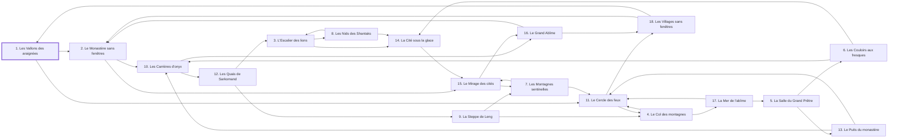

# Lieux — Plateau de Leng

Graine : `1798655270` · Lieux : 18 · Départ : **Les Vallons des araignées**

## Carte des liens



## Tableau des liens

| # | Lieu | Mène à | Mène à |
|---|------|--------|--------|
| 1 | **Les Vallons des araignées** (départ) | Le Monastère sans fenêtres | Le Cercle des feux |
| 2 | Le Monastère sans fenêtres | Les Carrières d'onyx | Le Mirage des cités |
| 3 | L'Escalier des lions | La Cité sous la glace | Les Nids des Shantaks |
| 4 | Le Col des montagnes | Le Cercle des feux | La Mer de l'abîme |
| 5 | La Salle du Grand Prêtre | Les Couloirs aux fresques | Le Puits du monastère |
| 6 | Les Couloirs aux fresques | Les Carrières d'onyx | La Cité sous la glace |
| 7 | Les Montagnes sentinelles | Le Mirage des cités | Le Cercle des feux |
| 8 | Les Nids des Shantaks | L'Escalier des lions | La Cité sous la glace |
| 9 | La Steppe de Leng | Le Col des montagnes | Les Montagnes sentinelles |
| 10 | Les Carrières d'onyx | Les Quais de Sarkomand | Le Grand Abîme |
| 11 | Le Cercle des feux | Les Villages sans fenêtres | Le Col des montagnes |
| 12 | Les Quais de Sarkomand | L'Escalier des lions | La Steppe de Leng |
| 13 | Le Puits du monastère | Les Carrières d'onyx | Le Cercle des feux |
| 14 | La Cité sous la glace | Le Mirage des cités | Le Mirage des cités |
| 15 | Le Mirage des cités | Les Montagnes sentinelles | Le Grand Abîme |
| 16 | Le Grand Abîme | Le Monastère sans fenêtres | Les Villages sans fenêtres |
| 17 | La Mer de l'abîme | Le Cercle des feux | La Salle du Grand Prêtre |
| 18 | Les Villages sans fenêtres | Le Monastère sans fenêtres | Les Vallons des araignées |

## Prompts

### 1. Les Vallons des araignées (départ)

Mène à : Le Monastère sans fenêtres, Le Cercle des feux

```
Illustre un vallon encaissé du plateau de Leng, entre deux pentes d'éboulis gris. D'énormes toiles d'araignée, épaisses comme des cordages et chargées de givre, sont tendues d'un rocher à l'autre et ferment presque le passage. Sous l'une d'elles, une hutte de pierre effondrée laisse encore voir sa porte basse, à moitié obstruée par les fils. Des brindilles et des touffes de laine grise sont prises dans les toiles. Aucune créature n'est visible. Le décor appartient au plateau de Leng décrit par H. P. Lovecraft, un haut plateau froid et maudit que les récits situent tantôt dans les Contrées du Rêve, tantôt aux confins glacés du monde éveillé. Tout y est ancien, désolé et hostile, hanté de présences qu'on ne voit jamais. L'étrangeté naît de l'échelle, de la géométrie et de l'ambiance, jamais de matières fantaisistes : pierre, glace, lichen, eau, plume et pelage restent crédibles. L'échelle se lit grâce à un élément d'architecture à taille humaine. Aucun personnage humain. Les gravures et les reliefs sont usés jusqu'à n'être plus que des formes abstraites, sans aucune lettre, aucun symbole ni hiéroglyphe lisible. Peinture numérique réaliste à la texture de gouache, palette de gris de lichen, d'ocres froids, de bruns de suie et de blancs de glace, relevée de rares touches de jaune soufré, lumière blafarde de crépuscule gris-violet, froide, diffuse et sans source visible. Paysage 16:9, 1536 × 864 px, scène unique plein cadre, sans texte ni lettres dans le décor, sans bordure, signature ni filigrane.
```

### 2. Le Monastère sans fenêtres

Mène à : Les Carrières d'onyx, Le Mirage des cités

```
Illustre le monastère préhistorique de Leng vu de l'extérieur, un édifice bas, massif et sans aucune fenêtre, posé seul au milieu du plateau. Ses murs de gros blocs gris mal équarris sont rongés par des millénaires de vent, et son toit plat se confond avec la plaine. Un cercle de menhirs bruts l'entoure à bonne distance. La seule ouverture est une porte basse à l'arche épaisse, précédée d'une marche unique creusée par l'usure. Le décor appartient au plateau de Leng décrit par H. P. Lovecraft, un haut plateau froid et maudit que les récits situent tantôt dans les Contrées du Rêve, tantôt aux confins glacés du monde éveillé. Tout y est ancien, désolé et hostile, hanté de présences qu'on ne voit jamais. L'étrangeté naît de l'échelle, de la géométrie et de l'ambiance, jamais de matières fantaisistes : pierre, glace, lichen, eau, plume et pelage restent crédibles. L'échelle se lit grâce à un élément d'architecture à taille humaine. Aucun personnage humain. Les gravures et les reliefs sont usés jusqu'à n'être plus que des formes abstraites, sans aucune lettre, aucun symbole ni hiéroglyphe lisible. Peinture numérique réaliste à la texture de gouache, palette de gris de lichen, d'ocres froids, de bruns de suie et de blancs de glace, relevée de rares touches de jaune soufré, lumière blafarde de crépuscule gris-violet, froide, diffuse et sans source visible. Paysage 16:9, 1536 × 864 px, scène unique plein cadre, sans texte ni lettres dans le décor, sans bordure, signature ni filigrane.
```

### 3. L'Escalier des lions

Mène à : La Cité sous la glace, Les Nids des Shantaks

```
Illustre la grande place de Sarkomand, au cœur des ruines, entourée de colonnes brisées et de murs effondrés couverts de mousse sombre. Au centre s'ouvre un escalier qui plonge sous terre, gardé par deux immenses lions ailés de diorite assis face à face. Les premières marches, à taille humaine, polies et fendues, disparaissent vite dans le noir. Des herbes sèches poussent entre les dalles, et les reliefs des socles sont effacés par l'érosion. Le décor appartient au plateau de Leng décrit par H. P. Lovecraft, un haut plateau froid et maudit que les récits situent tantôt dans les Contrées du Rêve, tantôt aux confins glacés du monde éveillé. Tout y est ancien, désolé et hostile, hanté de présences qu'on ne voit jamais. L'étrangeté naît de l'échelle, de la géométrie et de l'ambiance, jamais de matières fantaisistes : pierre, glace, lichen, eau, plume et pelage restent crédibles. L'échelle se lit grâce à un élément d'architecture à taille humaine. Aucun personnage humain. Les gravures et les reliefs sont usés jusqu'à n'être plus que des formes abstraites, sans aucune lettre, aucun symbole ni hiéroglyphe lisible. Peinture numérique réaliste à la texture de gouache, palette de gris de lichen, d'ocres froids, de bruns de suie et de blancs de glace, relevée de rares touches de jaune soufré, lumière blafarde de crépuscule gris-violet, froide, diffuse et sans source visible. Paysage 16:9, 1536 × 864 px, scène unique plein cadre, sans texte ni lettres dans le décor, sans bordure, signature ni filigrane.
```

### 4. Le Col des montagnes

Mène à : Le Cercle des feux, La Mer de l'abîme

```
Illustre un col au sommet des montagnes noires qui bordent le plateau glacé, des pics plus hauts que tous ceux du monde, striés de neige. Sur leurs flancs s'accrochent des structures cubiques régulières, si anciennes qu'elles se confondent avec la roche. Le col est une étroite brèche balayée par le vent, où des encoches taillées pour un pied humain permettent de franchir la dernière paroi. Au-delà, le plateau s'étend, immense et désert, sous un ciel bas. Le décor appartient au plateau de Leng décrit par H. P. Lovecraft, un haut plateau froid et maudit que les récits situent tantôt dans les Contrées du Rêve, tantôt aux confins glacés du monde éveillé. Tout y est ancien, désolé et hostile, hanté de présences qu'on ne voit jamais. L'étrangeté naît de l'échelle, de la géométrie et de l'ambiance, jamais de matières fantaisistes : pierre, glace, lichen, eau, plume et pelage restent crédibles. L'échelle se lit grâce à un élément d'architecture à taille humaine. Aucun personnage humain. Les gravures et les reliefs sont usés jusqu'à n'être plus que des formes abstraites, sans aucune lettre, aucun symbole ni hiéroglyphe lisible. Peinture numérique réaliste à la texture de gouache, palette de gris de lichen, d'ocres froids, de bruns de suie et de blancs de glace, relevée de rares touches de jaune soufré, lumière blafarde de crépuscule gris-violet, froide, diffuse et sans source visible. Paysage 16:9, 1536 × 864 px, scène unique plein cadre, sans texte ni lettres dans le décor, sans bordure, signature ni filigrane.
```

### 5. La Salle du Grand Prêtre

Mène à : Les Couloirs aux fresques, Le Puits du monastère

```
Illustre la salle centrale du monastère de Leng, une vaste rotonde en dôme aux murs de pierre nue. Au centre s'élève une estrade de quelques marches à hauteur de pas humain, portant un trône de pierre massif et vide. Derrière, un lourd rideau de soie jaune fanée tombe de la voûte jusqu'au sol, immobile. Autour de l'estrade, le dallage dessine des cercles concentriques de pierres claires et sombres. L'air semble figé depuis des millénaires. Le décor appartient au plateau de Leng décrit par H. P. Lovecraft, un haut plateau froid et maudit que les récits situent tantôt dans les Contrées du Rêve, tantôt aux confins glacés du monde éveillé. Tout y est ancien, désolé et hostile, hanté de présences qu'on ne voit jamais. L'étrangeté naît de l'échelle, de la géométrie et de l'ambiance, jamais de matières fantaisistes : pierre, glace, lichen, eau, plume et pelage restent crédibles. L'échelle se lit grâce à un élément d'architecture à taille humaine. Aucun personnage humain. Les gravures et les reliefs sont usés jusqu'à n'être plus que des formes abstraites, sans aucune lettre, aucun symbole ni hiéroglyphe lisible. Peinture numérique réaliste à la texture de gouache, palette de gris de lichen, d'ocres froids, de bruns de suie et de blancs de glace, relevée de rares touches de jaune soufré, lumière blafarde de crépuscule gris-violet, froide, diffuse et sans source visible. Paysage 16:9, 1536 × 864 px, scène unique plein cadre, sans texte ni lettres dans le décor, sans bordure, signature ni filigrane.
```

### 6. Les Couloirs aux fresques

Mène à : Les Carrières d'onyx, La Cité sous la glace

```
Illustre un couloir intérieur du monastère de Leng, étroit et interminable, au plafond si bas qu'il frôlerait la tête d'un homme. Les murs portent des fresques si anciennes et si écaillées qu'il n'en reste que des taches de pigment ocre et rouge et des reliefs abstraits. Le dallage est creusé en son milieu par l'usure, et le couloir tourne à angle droit vers d'autres couloirs semblables. Une niche basse et vide s'ouvre dans la paroi. Une faible lueur sans origine éclaire la pierre. Le décor appartient au plateau de Leng décrit par H. P. Lovecraft, un haut plateau froid et maudit que les récits situent tantôt dans les Contrées du Rêve, tantôt aux confins glacés du monde éveillé. Tout y est ancien, désolé et hostile, hanté de présences qu'on ne voit jamais. L'étrangeté naît de l'échelle, de la géométrie et de l'ambiance, jamais de matières fantaisistes : pierre, glace, lichen, eau, plume et pelage restent crédibles. L'échelle se lit grâce à un élément d'architecture à taille humaine. Aucun personnage humain. Les gravures et les reliefs sont usés jusqu'à n'être plus que des formes abstraites, sans aucune lettre, aucun symbole ni hiéroglyphe lisible. Peinture numérique réaliste à la texture de gouache, palette de gris de lichen, d'ocres froids, de bruns de suie et de blancs de glace, relevée de rares touches de jaune soufré, lumière blafarde de crépuscule gris-violet, froide, diffuse et sans source visible. Paysage 16:9, 1536 × 864 px, scène unique plein cadre, sans texte ni lettres dans le décor, sans bordure, signature ni filigrane.
```

### 7. Les Montagnes sentinelles

Mène à : Le Mirage des cités, Le Cercle des feux

```
Illustre la chaîne qui ferme le plateau de Leng au nord, des pics gris dont les sommets ont été sculptés, en des temps oubliés, en formes accroupies colossales tournées vers le plateau. Leur silhouette est si érodée qu'on hésite entre la roche et la statue. À leurs pieds s'étend une plaine de cailloux glacés. Au premier plan, un sentier franchit un ravin sur un pont de pierre sèche large d'un seul pas, bordé d'un parapet bas. Le décor appartient au plateau de Leng décrit par H. P. Lovecraft, un haut plateau froid et maudit que les récits situent tantôt dans les Contrées du Rêve, tantôt aux confins glacés du monde éveillé. Tout y est ancien, désolé et hostile, hanté de présences qu'on ne voit jamais. L'étrangeté naît de l'échelle, de la géométrie et de l'ambiance, jamais de matières fantaisistes : pierre, glace, lichen, eau, plume et pelage restent crédibles. L'échelle se lit grâce à un élément d'architecture à taille humaine. Aucun personnage humain. Les gravures et les reliefs sont usés jusqu'à n'être plus que des formes abstraites, sans aucune lettre, aucun symbole ni hiéroglyphe lisible. Peinture numérique réaliste à la texture de gouache, palette de gris de lichen, d'ocres froids, de bruns de suie et de blancs de glace, relevée de rares touches de jaune soufré, lumière blafarde de crépuscule gris-violet, froide, diffuse et sans source visible. Paysage 16:9, 1536 × 864 px, scène unique plein cadre, sans texte ni lettres dans le décor, sans bordure, signature ni filigrane.
```

### 8. Les Nids des Shantaks

Mène à : L'Escalier des lions, La Cité sous la glace

```
Illustre les falaises qui bordent le plateau de Leng, vues depuis le ciel : une muraille de roc gris qui plonge dans une mer de nuages. Dans la paroi s'ouvrent d'immenses cavités creusées par le vent, garnies de nids énormes faits de branches mortes et de plumes sales. Le long de la falaise court une ancienne corniche taillée, bordée d'un parapet à hauteur de hanche, qui donne la mesure du gigantisme des nids. Des rafales arrachent des lambeaux de brume aux arêtes. Aucune créature n'est visible. Le décor appartient au plateau de Leng décrit par H. P. Lovecraft, un haut plateau froid et maudit que les récits situent tantôt dans les Contrées du Rêve, tantôt aux confins glacés du monde éveillé. Tout y est ancien, désolé et hostile, hanté de présences qu'on ne voit jamais. L'étrangeté naît de l'échelle, de la géométrie et de l'ambiance, jamais de matières fantaisistes : pierre, glace, lichen, eau, plume et pelage restent crédibles. L'échelle se lit grâce à un élément d'architecture à taille humaine. Aucun personnage humain. Les gravures et les reliefs sont usés jusqu'à n'être plus que des formes abstraites, sans aucune lettre, aucun symbole ni hiéroglyphe lisible. Peinture numérique réaliste à la texture de gouache, palette de gris de lichen, d'ocres froids, de bruns de suie et de blancs de glace, relevée de rares touches de jaune soufré, lumière blafarde de crépuscule gris-violet, froide, diffuse et sans source visible. Paysage 16:9, 1536 × 864 px, scène unique plein cadre, sans texte ni lettres dans le décor, sans bordure, signature ni filigrane.
```

### 9. La Steppe de Leng

Mène à : Le Col des montagnes, Les Montagnes sentinelles

```
Illustre la steppe du plateau de Leng, une immense étendue froide et ondulée où ne poussent que des herbes rases, des plaques de lichen gris et quelques buissons nains couchés par le vent. Une piste de terre battue serpente vers l'horizon entre des rochers dressés, rongés par le gel. Au premier plan, un muret de pierres sèches à hauteur de genou longe la piste, interrompu par une marche grossièrement taillée dans le roc. Le ciel bas pèse sur le plateau, et rien ne bouge à perte de vue. Le décor appartient au plateau de Leng décrit par H. P. Lovecraft, un haut plateau froid et maudit que les récits situent tantôt dans les Contrées du Rêve, tantôt aux confins glacés du monde éveillé. Tout y est ancien, désolé et hostile, hanté de présences qu'on ne voit jamais. L'étrangeté naît de l'échelle, de la géométrie et de l'ambiance, jamais de matières fantaisistes : pierre, glace, lichen, eau, plume et pelage restent crédibles. L'échelle se lit grâce à un élément d'architecture à taille humaine. Aucun personnage humain. Les gravures et les reliefs sont usés jusqu'à n'être plus que des formes abstraites, sans aucune lettre, aucun symbole ni hiéroglyphe lisible. Peinture numérique réaliste à la texture de gouache, palette de gris de lichen, d'ocres froids, de bruns de suie et de blancs de glace, relevée de rares touches de jaune soufré, lumière blafarde de crépuscule gris-violet, froide, diffuse et sans source visible. Paysage 16:9, 1536 × 864 px, scène unique plein cadre, sans texte ni lettres dans le décor, sans bordure, signature ni filigrane.
```

### 10. Les Carrières d'onyx

Mène à : Les Quais de Sarkomand, Le Grand Abîme

```
Illustre les carrières d'onyx qui bordent le plateau de Leng, une immense fosse creusée dans la montagne noire, aux parois lisses et lustrées. Les blocs en ont été extraits à une échelle démesurée : chaque entaille laissée dans la paroi est haute comme une tour. Dans un angle, une volée de marches à taille humaine a été taillée dans la roche, minuscule à côté des entailles. Au fond de la fosse, un bassin d'eau noire reflète le ciel. Le décor appartient au plateau de Leng décrit par H. P. Lovecraft, un haut plateau froid et maudit que les récits situent tantôt dans les Contrées du Rêve, tantôt aux confins glacés du monde éveillé. Tout y est ancien, désolé et hostile, hanté de présences qu'on ne voit jamais. L'étrangeté naît de l'échelle, de la géométrie et de l'ambiance, jamais de matières fantaisistes : pierre, glace, lichen, eau, plume et pelage restent crédibles. L'échelle se lit grâce à un élément d'architecture à taille humaine. Aucun personnage humain. Les gravures et les reliefs sont usés jusqu'à n'être plus que des formes abstraites, sans aucune lettre, aucun symbole ni hiéroglyphe lisible. Peinture numérique réaliste à la texture de gouache, palette de gris de lichen, d'ocres froids, de bruns de suie et de blancs de glace, relevée de rares touches de jaune soufré, lumière blafarde de crépuscule gris-violet, froide, diffuse et sans source visible. Paysage 16:9, 1536 × 864 px, scène unique plein cadre, sans texte ni lettres dans le décor, sans bordure, signature ni filigrane.
```

### 11. Le Cercle des feux

Mène à : Les Villages sans fenêtres, Le Col des montagnes

```
Illustre une colline arrondie du plateau de Leng, couronnée d'un cercle de pierres levées noircies par la suie. Au centre, un large foyer de cendres froides est entouré d'un sol damé par d'innombrables pas. Sur les collines voisines, au loin, brûlent des feux pâles dont aucune fumée ne s'élève. Une volée de marches à taille humaine, taillées dans le flanc de la colline, monte vers le cercle. Le vent fait courir des cendres sur les pierres. Le décor appartient au plateau de Leng décrit par H. P. Lovecraft, un haut plateau froid et maudit que les récits situent tantôt dans les Contrées du Rêve, tantôt aux confins glacés du monde éveillé. Tout y est ancien, désolé et hostile, hanté de présences qu'on ne voit jamais. L'étrangeté naît de l'échelle, de la géométrie et de l'ambiance, jamais de matières fantaisistes : pierre, glace, lichen, eau, plume et pelage restent crédibles. L'échelle se lit grâce à un élément d'architecture à taille humaine. Aucun personnage humain. Les gravures et les reliefs sont usés jusqu'à n'être plus que des formes abstraites, sans aucune lettre, aucun symbole ni hiéroglyphe lisible. Peinture numérique réaliste à la texture de gouache, palette de gris de lichen, d'ocres froids, de bruns de suie et de blancs de glace, relevée de rares touches de jaune soufré, lumière blafarde de crépuscule gris-violet, froide, diffuse et sans source visible. Paysage 16:9, 1536 × 864 px, scène unique plein cadre, sans texte ni lettres dans le décor, sans bordure, signature ni filigrane.
```

### 12. Les Quais de Sarkomand

Mène à : L'Escalier des lions, La Steppe de Leng

```
Illustre les quais de basalte de Sarkomand, la cité morte qui marque le bord du plateau de Leng face à la mer. De longs quais de pierre noire, fendus et couverts d'algues sèches, descendent vers une mer grise et lente. Des bornes d'amarrage usées s'alignent le long d'un parapet à hauteur de hanche, et des escaliers de quelques marches plongent dans l'eau. Derrière, les façades effondrées de la cité se dressent en silhouettes sombres. Aucun navire n'est en vue. Le décor appartient au plateau de Leng décrit par H. P. Lovecraft, un haut plateau froid et maudit que les récits situent tantôt dans les Contrées du Rêve, tantôt aux confins glacés du monde éveillé. Tout y est ancien, désolé et hostile, hanté de présences qu'on ne voit jamais. L'étrangeté naît de l'échelle, de la géométrie et de l'ambiance, jamais de matières fantaisistes : pierre, glace, lichen, eau, plume et pelage restent crédibles. L'échelle se lit grâce à un élément d'architecture à taille humaine. Aucun personnage humain. Les gravures et les reliefs sont usés jusqu'à n'être plus que des formes abstraites, sans aucune lettre, aucun symbole ni hiéroglyphe lisible. Peinture numérique réaliste à la texture de gouache, palette de gris de lichen, d'ocres froids, de bruns de suie et de blancs de glace, relevée de rares touches de jaune soufré, lumière blafarde de crépuscule gris-violet, froide, diffuse et sans source visible. Paysage 16:9, 1536 × 864 px, scène unique plein cadre, sans texte ni lettres dans le décor, sans bordure, signature ni filigrane.
```

### 13. Le Puits du monastère

Mène à : Les Carrières d'onyx, Le Cercle des feux

```
Illustre le puits qui s'enfonce sous le monastère de Leng, un large conduit circulaire taillé dans le roc et plongeant dans une obscurité complète. Un escalier en colimaçon sans rampe est creusé à même la paroi, ses marches étroites juste assez larges pour un pied humain. La vue est prise d'en haut, depuis la margelle, et la spirale rétrécit jusqu'à disparaître. Des suintements d'eau glacée luisent sur la pierre. Le décor appartient au plateau de Leng décrit par H. P. Lovecraft, un haut plateau froid et maudit que les récits situent tantôt dans les Contrées du Rêve, tantôt aux confins glacés du monde éveillé. Tout y est ancien, désolé et hostile, hanté de présences qu'on ne voit jamais. L'étrangeté naît de l'échelle, de la géométrie et de l'ambiance, jamais de matières fantaisistes : pierre, glace, lichen, eau, plume et pelage restent crédibles. L'échelle se lit grâce à un élément d'architecture à taille humaine. Aucun personnage humain. Les gravures et les reliefs sont usés jusqu'à n'être plus que des formes abstraites, sans aucune lettre, aucun symbole ni hiéroglyphe lisible. Peinture numérique réaliste à la texture de gouache, palette de gris de lichen, d'ocres froids, de bruns de suie et de blancs de glace, relevée de rares touches de jaune soufré, lumière blafarde de crépuscule gris-violet, froide, diffuse et sans source visible. Paysage 16:9, 1536 × 864 px, scène unique plein cadre, sans texte ni lettres dans le décor, sans bordure, signature ni filigrane.
```

### 14. La Cité sous la glace

Mène à : Le Mirage des cités

```
Illustre la cité morte des Anciens sur le plateau glacé, un dédale de bâtiments cyclopéens en blocs de pierre sombre, cubes, cônes tronqués et terrasses, à demi pris dans la glace. Des tours à cinq branches se dressent, brisées à mi-hauteur. Les ouvertures sont immenses, mais dans le mur d'une rampe s'ouvre une porte basse, plus tardive, à la taille d'un homme. Des congères remplissent les rues jusqu'à mi-façade, et les reliefs des murs sont usés jusqu'à l'abstraction. Le décor appartient au plateau de Leng décrit par H. P. Lovecraft, un haut plateau froid et maudit que les récits situent tantôt dans les Contrées du Rêve, tantôt aux confins glacés du monde éveillé. Tout y est ancien, désolé et hostile, hanté de présences qu'on ne voit jamais. L'étrangeté naît de l'échelle, de la géométrie et de l'ambiance, jamais de matières fantaisistes : pierre, glace, lichen, eau, plume et pelage restent crédibles. L'échelle se lit grâce à un élément d'architecture à taille humaine. Aucun personnage humain. Les gravures et les reliefs sont usés jusqu'à n'être plus que des formes abstraites, sans aucune lettre, aucun symbole ni hiéroglyphe lisible. Peinture numérique réaliste à la texture de gouache, palette de gris de lichen, d'ocres froids, de bruns de suie et de blancs de glace, relevée de rares touches de jaune soufré, lumière blafarde de crépuscule gris-violet, froide, diffuse et sans source visible. Paysage 16:9, 1536 × 864 px, scène unique plein cadre, sans texte ni lettres dans le décor, sans bordure, signature ni filigrane.
```

### 15. Le Mirage des cités

Mène à : Les Montagnes sentinelles, Le Grand Abîme

```
Illustre un mirage au-dessus du plateau glacé de Leng, aux confins du monde : dans le ciel bas flotte, renversée, la silhouette d'une cité immense faite de cubes, de cônes et de terrasses empilés. En dessous, une plaine de neige durcie par le vent s'étend jusqu'à l'horizon, striée de crêtes de glace. Au premier plan, un ancien parapet de pierre à demi enseveli dépasse de la neige. L'air froid vibre et dédouble les formes. Le décor appartient au plateau de Leng décrit par H. P. Lovecraft, un haut plateau froid et maudit que les récits situent tantôt dans les Contrées du Rêve, tantôt aux confins glacés du monde éveillé. Tout y est ancien, désolé et hostile, hanté de présences qu'on ne voit jamais. L'étrangeté naît de l'échelle, de la géométrie et de l'ambiance, jamais de matières fantaisistes : pierre, glace, lichen, eau, plume et pelage restent crédibles. L'échelle se lit grâce à un élément d'architecture à taille humaine. Aucun personnage humain. Les gravures et les reliefs sont usés jusqu'à n'être plus que des formes abstraites, sans aucune lettre, aucun symbole ni hiéroglyphe lisible. Peinture numérique réaliste à la texture de gouache, palette de gris de lichen, d'ocres froids, de bruns de suie et de blancs de glace, relevée de rares touches de jaune soufré, lumière blafarde de crépuscule gris-violet, froide, diffuse et sans source visible. Paysage 16:9, 1536 × 864 px, scène unique plein cadre, sans texte ni lettres dans le décor, sans bordure, signature ni filigrane.
```

### 16. Le Grand Abîme

Mène à : Le Monastère sans fenêtres, Les Villages sans fenêtres

```
Illustre le Grand Abîme qui s'ouvre sous Sarkomand, une caverne d'une hauteur vertigineuse dont le fond et la voûte se perdent dans l'obscurité. Au premier plan, l'escalier venu des ruines débouche sur un palier de pierre bordé d'un parapet bas, suspendu au-dessus du vide. Des arches naturelles traversent l'espace d'une paroi à l'autre comme des ponts sans garde-fou. De lents courants d'air froid soulèvent une poussière fine. Le décor appartient au plateau de Leng décrit par H. P. Lovecraft, un haut plateau froid et maudit que les récits situent tantôt dans les Contrées du Rêve, tantôt aux confins glacés du monde éveillé. Tout y est ancien, désolé et hostile, hanté de présences qu'on ne voit jamais. L'étrangeté naît de l'échelle, de la géométrie et de l'ambiance, jamais de matières fantaisistes : pierre, glace, lichen, eau, plume et pelage restent crédibles. L'échelle se lit grâce à un élément d'architecture à taille humaine. Aucun personnage humain. Les gravures et les reliefs sont usés jusqu'à n'être plus que des formes abstraites, sans aucune lettre, aucun symbole ni hiéroglyphe lisible. Peinture numérique réaliste à la texture de gouache, palette de gris de lichen, d'ocres froids, de bruns de suie et de blancs de glace, relevée de rares touches de jaune soufré, lumière blafarde de crépuscule gris-violet, froide, diffuse et sans source visible. Paysage 16:9, 1536 × 864 px, scène unique plein cadre, sans texte ni lettres dans le décor, sans bordure, signature ni filigrane.
```

### 17. La Mer de l'abîme

Mène à : Le Cercle des feux, La Salle du Grand Prêtre

```
Illustre la mer souterraine qui dort sous le plateau glacé, une immense caverne où une eau noire et immobile s'étend à perte de vue. Sur la grève de galets, de grands manchots albinos et aveugles se tiennent immobiles, leur plumage blanc à peine visible dans la pénombre. Une rampe de pierre taillée descend jusqu'à l'eau, bordée d'un muret à hauteur de genou. La voûte se perd dans les ténèbres, et une vapeur tiède flotte au ras de l'eau. Le décor appartient au plateau de Leng décrit par H. P. Lovecraft, un haut plateau froid et maudit que les récits situent tantôt dans les Contrées du Rêve, tantôt aux confins glacés du monde éveillé. Tout y est ancien, désolé et hostile, hanté de présences qu'on ne voit jamais. L'étrangeté naît de l'échelle, de la géométrie et de l'ambiance, jamais de matières fantaisistes : pierre, glace, lichen, eau, plume et pelage restent crédibles. L'échelle se lit grâce à un élément d'architecture à taille humaine. Aucun personnage humain. Les gravures et les reliefs sont usés jusqu'à n'être plus que des formes abstraites, sans aucune lettre, aucun symbole ni hiéroglyphe lisible. Peinture numérique réaliste à la texture de gouache, palette de gris de lichen, d'ocres froids, de bruns de suie et de blancs de glace, relevée de rares touches de jaune soufré, lumière blafarde de crépuscule gris-violet, froide, diffuse et sans source visible. Paysage 16:9, 1536 × 864 px, scène unique plein cadre, sans texte ni lettres dans le décor, sans bordure, signature ni filigrane.
```

### 18. Les Villages sans fenêtres

Mène à : Le Monastère sans fenêtres, Les Vallons des araignées

```
Illustre un village du plateau de Leng, un amas de huttes rondes en pierres sèches, basses et trapues, sans une seule fenêtre. Les toits de dalles plates sont lestés de pierres contre le vent, et aucune fumée n'en sort. Chaque hutte n'a qu'une porte basse et étroite, qu'un homme ne franchirait qu'en se courbant, fermée par un rideau de peau usée. Entre les huttes, des sentiers boueux convergent vers une pierre levée lisse. Les environs sont déserts et silencieux. Le décor appartient au plateau de Leng décrit par H. P. Lovecraft, un haut plateau froid et maudit que les récits situent tantôt dans les Contrées du Rêve, tantôt aux confins glacés du monde éveillé. Tout y est ancien, désolé et hostile, hanté de présences qu'on ne voit jamais. L'étrangeté naît de l'échelle, de la géométrie et de l'ambiance, jamais de matières fantaisistes : pierre, glace, lichen, eau, plume et pelage restent crédibles. L'échelle se lit grâce à un élément d'architecture à taille humaine. Aucun personnage humain. Les gravures et les reliefs sont usés jusqu'à n'être plus que des formes abstraites, sans aucune lettre, aucun symbole ni hiéroglyphe lisible. Peinture numérique réaliste à la texture de gouache, palette de gris de lichen, d'ocres froids, de bruns de suie et de blancs de glace, relevée de rares touches de jaune soufré, lumière blafarde de crépuscule gris-violet, froide, diffuse et sans source visible. Paysage 16:9, 1536 × 864 px, scène unique plein cadre, sans texte ni lettres dans le décor, sans bordure, signature ni filigrane.
```
