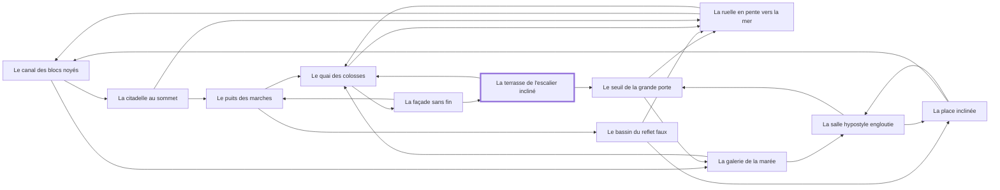

# R'lyeh — lieux de l'autre monde

Graine du tirage : `7`

## Carte des liens



## Tableau des liens

| # | Lieu | Mène à | Mène à |
|---|------|--------|--------|
| 1 | Le canal des blocs noyés | La citadelle au sommet | La galerie de la marée |
| 2 | Le seuil de la grande porte | La galerie de la marée | La ruelle en pente vers la mer |
| 3 | Le bassin du reflet faux | La ruelle en pente vers la mer | La place inclinée |
| 4 | Le quai des colosses | La ruelle en pente vers la mer | La façade sans fin |
| 5 | Le puits des marches | Le quai des colosses | Le bassin du reflet faux |
| 6 | La salle hypostyle engloutie | Le seuil de la grande porte | La place inclinée |
| 7 | La ruelle en pente vers la mer | Le canal des blocs noyés | Le quai des colosses |
| 8 | La galerie de la marée | La salle hypostyle engloutie | Le quai des colosses |
| 9 | La citadelle au sommet | Le puits des marches | La ruelle en pente vers la mer |
| 10 | La place inclinée | Le canal des blocs noyés | La salle hypostyle engloutie |
| 11 | La terrasse de l'escalier incliné (départ) | Le seuil de la grande porte | Le quai des colosses |
| 12 | La façade sans fin | La terrasse de l'escalier incliné | Le puits des marches |

## Lieux

### 1. Le canal des blocs noyés

Mène à : La citadelle au sommet, La galerie de la marée

```text
Illustre une avenue de R'lyeh inondée qui forme un canal entre des façades cyclopéennes. L'eau noire et immobile reflète les murs, mais le reflet ne correspond pas à leur géométrie. Des algues flottent entre les blocs à demi immergés et une lueur jaune perce la brume au bout du canal. Atmosphère d'après tempête, humide et oppressante, aucun personnage humain. Rends chaque surface et chaque ombre crédible pour que l'étrangeté vienne de la géométrie. Peinture numérique réaliste à la texture de gouache, verts d'algues, gris d'orage et reflets d'or terne. Paysage 16:9, 1536 × 864 px, scène unique plein cadre, sans texte, bordure, signature ni filigrane.
```

### 2. Le seuil de la grande porte

Mène à : La galerie de la marée, La ruelle en pente vers la mer

```text
Illustre une porte monolithique de R'lyeh, une dalle colossale nue et lisse, entrouverte dans son encadrement. On ne saurait dire si elle s'ouvre vers l'intérieur ou vers l'extérieur, car son épaisseur et son ombre se contredisent. Un filet d'eau s'échappe par l'interstice et une lueur jaune pâle baigne le seuil détrempé. Atmosphère d'après tempête, humide et oppressante, aucun personnage humain. Rends chaque surface et chaque ombre crédible pour que l'étrangeté vienne de la géométrie. Peinture numérique réaliste à la texture de gouache, verts d'algues, gris d'orage et reflets d'or terne. Paysage 16:9, 1536 × 864 px, scène unique plein cadre, sans texte, bordure, signature ni filigrane.
```

### 3. Le bassin du reflet faux

Mène à : La ruelle en pente vers la mer, La place inclinée

```text
Illustre un bassin rectangulaire de R'lyeh entouré de murs monolithiques, rempli d'une eau parfaitement lisse. Dans l'eau se reflète une arche qui n'existe nulle part autour du bassin. Les murs ruissellent et une lueur jaune tombe en biais sur la surface. Atmosphère d'après tempête, humide et oppressante, aucun personnage humain. Rends chaque surface et chaque ombre crédible pour que l'étrangeté vienne de la géométrie. Peinture numérique réaliste à la texture de gouache, verts d'algues, gris d'orage et reflets d'or terne. Paysage 16:9, 1536 × 864 px, scène unique plein cadre, sans texte, bordure, signature ni filigrane.
```

### 4. Le quai des colosses

Mène à : La ruelle en pente vers la mer, La façade sans fin

```text
Illustre un quai de R'lyeh bordé de blocs d'amarrage aussi hauts que des tours, vu depuis la surface de l'eau. Les blocs s'alignent en une rangée parfaitement droite qui semble pourtant s'incurver vers le large. Des paquets d'algues pendent de leurs arêtes et la houle grise vient battre leur base dans une lumière d'or terne. Atmosphère d'après tempête, humide et oppressante, aucun personnage humain. Rends chaque surface et chaque ombre crédible pour que l'étrangeté vienne de la géométrie. Peinture numérique réaliste à la texture de gouache, verts d'algues, gris d'orage et reflets d'or terne. Paysage 16:9, 1536 × 864 px, scène unique plein cadre, sans texte, bordure, signature ni filigrane.
```

### 5. Le puits des marches

Mène à : Le quai des colosses, Le bassin du reflet faux

```text
Illustre un puits vertical à l'intérieur de R'lyeh, vu d'en haut, dont les parois portent un escalier qui s'enroule vers une eau noire au fond. L'escalier semble tourner dans les deux sens à la fois. L'eau suinte des parois et une lueur jaune remonte faiblement du fond. Atmosphère d'après tempête, humide et oppressante, aucun personnage humain. Rends chaque surface et chaque ombre crédible pour que l'étrangeté vienne de la géométrie. Peinture numérique réaliste à la texture de gouache, verts d'algues, gris d'orage et reflets d'or terne. Paysage 16:9, 1536 × 864 px, scène unique plein cadre, sans texte, bordure, signature ni filigrane.
```

### 6. La salle hypostyle engloutie

Mène à : Le seuil de la grande porte, La place inclinée

```text
Illustre l'intérieur d'une salle immense de R'lyeh, une forêt de piliers colossaux à demi plongés dans une eau verte. Les piliers sont alignés en rangées qui convergent vers deux points de fuite différents. Une fente haute dans la voûte laisse tomber un rai de lumière jaune qui frappe l'eau. Atmosphère d'après tempête, humide et oppressante, aucun personnage humain. Rends chaque surface et chaque ombre crédible pour que l'étrangeté vienne de la géométrie. Peinture numérique réaliste à la texture de gouache, verts d'algues, gris d'orage et reflets d'or terne. Paysage 16:9, 1536 × 864 px, scène unique plein cadre, sans texte, bordure, signature ni filigrane.
```

### 7. La ruelle en pente vers la mer

Mène à : Le canal des blocs noyés, Le quai des colosses

```text
Illustre une ruelle de R'lyeh, un escalier étroit coincé entre deux murs cyclopéens, qui descend vers une échappée de mer grise. L'eau de pluie dévale les marches en petites cascades. Les marches paraissent monter et descendre à la fois, et une lumière jaune sourd au bout de la ruelle. Atmosphère d'après tempête, humide et oppressante, aucun personnage humain. Rends chaque surface et chaque ombre crédible pour que l'étrangeté vienne de la géométrie. Peinture numérique réaliste à la texture de gouache, verts d'algues, gris d'orage et reflets d'or terne. Paysage 16:9, 1536 × 864 px, scène unique plein cadre, sans texte, bordure, signature ni filigrane.
```

### 8. La galerie de la marée

Mène à : La salle hypostyle engloutie, Le quai des colosses

```text
Illustre une galerie intérieure de R'lyeh, un couloir de blocs cyclopéens assez large pour un navire. L'eau de mer y entre en vague basse et se retire en laissant les dalles luisantes. Les parois paraissent parallèles mais la galerie se rétrécit et s'élargit à la fois. Une lumière d'or terne vient d'une ouverture au loin. Atmosphère d'après tempête, humide et oppressante, aucun personnage humain. Rends chaque surface et chaque ombre crédible pour que l'étrangeté vienne de la géométrie. Peinture numérique réaliste à la texture de gouache, verts d'algues, gris d'orage et reflets d'or terne. Paysage 16:9, 1536 × 864 px, scène unique plein cadre, sans texte, bordure, signature ni filigrane.
```

### 9. La citadelle au sommet

Mène à : Le puits des marches, La ruelle en pente vers la mer

```text
Illustre le sommet de R'lyeh, un amas de monolithes empilés en citadelle, vu depuis une esplanade plus basse. Les volumes s'emboîtent selon des plans qui ne concordent jamais tout à fait, comme une maquette assemblée par plusieurs architectes. Des cascades d'eau de mer dévalent ses flancs et une déchirure dorée s'ouvre dans le ciel d'orage au-dessus d'elle. Atmosphère d'après tempête, humide et oppressante, aucun personnage humain. Rends chaque surface et chaque ombre crédible pour que l'étrangeté vienne de la géométrie. Peinture numérique réaliste à la texture de gouache, verts d'algues, gris d'orage et reflets d'or terne. Paysage 16:9, 1536 × 864 px, scène unique plein cadre, sans texte, bordure, signature ni filigrane.
```

### 10. La place inclinée

Mène à : Le canal des blocs noyés, La salle hypostyle engloutie

```text
Illustre une vaste place de R'lyeh dallée de blocs plats, entourée de façades massives. Toute la place est inclinée, et pourtant l'eau des flaques semble couler vers le haut de la pente. Les colonnes autour restent verticales par rapport à l'horizon alors que le sol penche. Une lumière dorée rasante allonge les ombres en sens contraires. Atmosphère d'après tempête, humide et oppressante, aucun personnage humain. Rends chaque surface et chaque ombre crédible pour que l'étrangeté vienne de la géométrie. Peinture numérique réaliste à la texture de gouache, verts d'algues, gris d'orage et reflets d'or terne. Paysage 16:9, 1536 × 864 px, scène unique plein cadre, sans texte, bordure, signature ni filigrane.
```

### 11. La terrasse de l'escalier incliné (départ)

Mène à : Le seuil de la grande porte, Le quai des colosses

```text
Illustre R'lyeh, une cité cyclopéenne qui émerge de l'océan après une tempête. Depuis une terrasse de pierre verte à fleur d'eau, le regard suit un escalier monumental qui débouche sous une arche inclinée. Les marches et l'arche semblent obéir à deux perspectives incompatibles. L'écume se retire en filets entre les blocs ruisselants et une lueur jaune perce les nuages au ras de l'horizon. Atmosphère d'après tempête, humide et oppressante, aucun personnage humain. Rends chaque surface et chaque ombre crédible pour que l'étrangeté vienne de la géométrie. Peinture numérique réaliste à la texture de gouache, verts d'algues, gris d'orage et reflets d'or terne. Paysage 16:9, 1536 × 864 px, scène unique plein cadre, sans texte, bordure, signature ni filigrane.
```

### 12. La façade sans fin

Mène à : La terrasse de l'escalier incliné, Le puits des marches

```text
Illustre un mur de R'lyeh si immense qu'il remplit tout le cadre, vu d'en bas, dans une contre-plongée vertigineuse. Ses blocs verdâtres, chacun grand comme une maison, ruissellent d'eau de mer. Une seule porte minuscule s'ouvre à sa base et donne l'échelle. La crête du mur se perd dans les nuages bas, frangés d'or terne. Atmosphère d'après tempête, humide et oppressante, aucun personnage humain. Rends chaque surface et chaque ombre crédible pour que l'étrangeté vienne de la géométrie. Peinture numérique réaliste à la texture de gouache, verts d'algues, gris d'orage et reflets d'or terne. Paysage 16:9, 1536 × 864 px, scène unique plein cadre, sans texte, bordure, signature ni filigrane.
```
