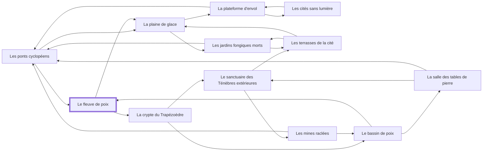

# Lieux de Yuggoth

Graine : `413699` — 12 lieux — départ : Le fleuve de poix

## Carte des liens



## Tableau des liens

| # | Lieu | Mène à | Mène à |
|---|---|---|---|
| 1 | Les ponts cyclopéens | Le fleuve de poix | La plaine de glace |
| 2 | La plateforme d'envol | Les ponts cyclopéens | Les cités sans lumière |
| 3 | Le fleuve de poix (départ) | La plaine de glace | La crypte du Trapézoèdre |
| 4 | La crypte du Trapézoèdre | Le sanctuaire des Ténèbres extérieures | Le bassin de poix |
| 5 | La salle des tables de pierre | Le sanctuaire des Ténèbres extérieures | Les ponts cyclopéens |
| 6 | Le bassin de poix | La salle des tables de pierre | Le fleuve de poix |
| 7 | Les cités sans lumière | La plateforme d'envol | La plateforme d'envol |
| 8 | Le sanctuaire des Ténèbres extérieures | Les terrasses de la cité | Les mines raclées |
| 9 | Les jardins fongiques morts | Les terrasses de la cité | Les ponts cyclopéens |
| 10 | Les terrasses de la cité | Les jardins fongiques morts | La plaine de glace |
| 11 | Les mines raclées | Le bassin de poix | Les ponts cyclopéens |
| 12 | La plaine de glace | La plateforme d'envol | Les jardins fongiques morts |

## Lieux

### 1. Les ponts cyclopéens

Mène à : Le fleuve de poix, La plaine de glace

```
Illustre un pont cyclopéen d'une seule arche, bâti en blocs colossaux par une race plus ancienne que les bâtisseurs des tours, qui enjambe un fleuve de poix. Les joints entre les blocs sont rongés, leurs gravures effacées en reliefs abstraits. Sur le tablier, un garde-corps percé d'encoches à hauteur de main humaine donne l'échelle de l'ouvrage. Lueur violette suspendue sous l'arche. Silence d'un monde abandonné aux confins du système solaire, sous un ciel noir où le soleil n'est qu'une étoile parmi d'autres ; air glacé et immobile, plus aucune matière vivante, machine ni objet, il ne reste que la pierre noire et les traces de ce qui a disparu. Aucun personnage ni créature. Tout a été bâti par et pour des êtres qui ne sont pas humains : rends chaque surface et chaque ombre crédible pour que l'étrangeté vienne de l'échelle, de la géométrie et du vide. Peinture numérique réaliste à la texture de gouache, noir minéral, bleu pétrole et violet profond, baignée d'une lumière violette et rose pâle sans source visible. Paysage 16:9, 1536 × 864 px, scène unique plein cadre, sans texte, bordure, signature ni filigrane.
```

### 2. La plateforme d'envol

Mène à : Les ponts cyclopéens, Les cités sans lumière

```
Illustre une plateforme de pierre noire suspendue au sommet d'une tour, ouverte sur le ciel noir piqué d'étoiles où le soleil n'est qu'un point. Le dallage est balayé, marqué seulement de traces d'usure rayonnantes au bord du vide. Un parapet à hauteur de taille humaine en ferme un côté. Lumière rose pâle sans origine qui lèche le rebord. Silence d'un monde abandonné aux confins du système solaire, sous un ciel noir où le soleil n'est qu'une étoile parmi d'autres ; air glacé et immobile, plus aucune matière vivante, machine ni objet, il ne reste que la pierre noire et les traces de ce qui a disparu. Aucun personnage ni créature. Tout a été bâti par et pour des êtres qui ne sont pas humains : rends chaque surface et chaque ombre crédible pour que l'étrangeté vienne de l'échelle, de la géométrie et du vide. Peinture numérique réaliste à la texture de gouache, noir minéral, bleu pétrole et violet profond, baignée d'une lumière violette et rose pâle sans source visible. Paysage 16:9, 1536 × 864 px, scène unique plein cadre, sans texte, bordure, signature ni filigrane.
```

### 3. Le fleuve de poix (départ)

Mène à : La plaine de glace, La crypte du Trapézoèdre

```
Illustre un fleuve de poix noire, épais et immobile en apparence, qui serpente entre des quais de pierre taillée. Sa surface huileuse renvoie des reflets violets sans qu'aucune source de lumière n'apparaisse. Des anneaux d'amarrage sans chaîne sont scellés dans le quai, et une volée de marches de hauteur humaine descend jusqu'au bord du flot. Silence d'un monde abandonné aux confins du système solaire, sous un ciel noir où le soleil n'est qu'une étoile parmi d'autres ; air glacé et immobile, plus aucune matière vivante, machine ni objet, il ne reste que la pierre noire et les traces de ce qui a disparu. Aucun personnage ni créature. Tout a été bâti par et pour des êtres qui ne sont pas humains : rends chaque surface et chaque ombre crédible pour que l'étrangeté vienne de l'échelle, de la géométrie et du vide. Peinture numérique réaliste à la texture de gouache, noir minéral, bleu pétrole et violet profond, baignée d'une lumière violette et rose pâle sans source visible. Paysage 16:9, 1536 × 864 px, scène unique plein cadre, sans texte, bordure, signature ni filigrane.
```

### 4. La crypte du Trapézoèdre

Mène à : Le sanctuaire des Ténèbres extérieures, Le bassin de poix

```
Illustre une crypte étroite et angulaire, aux parois taillées en facettes irrégulières. Au centre, un socle de pierre porte un renfoncement polyédrique vide et un cercle d'usure là où un coffret a été retiré. Les reliefs des murs sont effacés en motifs abstraits. Une niche à hauteur d'homme s'ouvre dans l'un des pans. Lumière rose pâle sans source, diffractée sur les arêtes. Silence d'un monde abandonné aux confins du système solaire, sous un ciel noir où le soleil n'est qu'une étoile parmi d'autres ; air glacé et immobile, plus aucune matière vivante, machine ni objet, il ne reste que la pierre noire et les traces de ce qui a disparu. Aucun personnage ni créature. Tout a été bâti par et pour des êtres qui ne sont pas humains : rends chaque surface et chaque ombre crédible pour que l'étrangeté vienne de l'échelle, de la géométrie et du vide. Peinture numérique réaliste à la texture de gouache, noir minéral, bleu pétrole et violet profond, baignée d'une lumière violette et rose pâle sans source visible. Paysage 16:9, 1536 × 864 px, scène unique plein cadre, sans texte, bordure, signature ni filigrane.
```

### 5. La salle des tables de pierre

Mène à : Le sanctuaire des Ténèbres extérieures, Les ponts cyclopéens

```
Illustre une salle basse où s'alignent des tables de pierre polie, vides, chacune creusée d'un léger renfoncement à sa surface. Le sol porte des cercles plus clairs autour de chaque table, et des rigoles sèches courent vers un orifice central. Une marche de hauteur humaine longe la rangée. Lueur violette égale, sans source visible. Silence d'un monde abandonné aux confins du système solaire, sous un ciel noir où le soleil n'est qu'une étoile parmi d'autres ; air glacé et immobile, plus aucune matière vivante, machine ni objet, il ne reste que la pierre noire et les traces de ce qui a disparu. Aucun personnage ni créature. Tout a été bâti par et pour des êtres qui ne sont pas humains : rends chaque surface et chaque ombre crédible pour que l'étrangeté vienne de l'échelle, de la géométrie et du vide. Peinture numérique réaliste à la texture de gouache, noir minéral, bleu pétrole et violet profond, baignée d'une lumière violette et rose pâle sans source visible. Paysage 16:9, 1536 × 864 px, scène unique plein cadre, sans texte, bordure, signature ni filigrane.
```

### 6. Le bassin de poix

Mène à : La salle des tables de pierre, Le fleuve de poix

```
Illustre un vaste bassin circulaire rempli de poix noire immobile, entouré de gradins de pierre. Des cercles concentriques plus clairs sur les marches trahissent d'anciens niveaux, et des anneaux sans chaîne sont scellés dans le rebord. Un escalier aux marches de hauteur humaine plonge sous la surface. Reflets rose pâle sur la poix, sans source visible. Silence d'un monde abandonné aux confins du système solaire, sous un ciel noir où le soleil n'est qu'une étoile parmi d'autres ; air glacé et immobile, plus aucune matière vivante, machine ni objet, il ne reste que la pierre noire et les traces de ce qui a disparu. Aucun personnage ni créature. Tout a été bâti par et pour des êtres qui ne sont pas humains : rends chaque surface et chaque ombre crédible pour que l'étrangeté vienne de l'échelle, de la géométrie et du vide. Peinture numérique réaliste à la texture de gouache, noir minéral, bleu pétrole et violet profond, baignée d'une lumière violette et rose pâle sans source visible. Paysage 16:9, 1536 × 864 px, scène unique plein cadre, sans texte, bordure, signature ni filigrane.
```

### 7. Les cités sans lumière

Mène à : La plateforme d'envol

```
Illustre une cité souterraine taillée sous la surface : rues profondes, façades sans ouvertures et voûtes perdues dans le noir. La poussière des rues porte des empreintes anciennes qui ne mènent nulle part. Au premier plan, une volée de marches de hauteur humaine descend vers une place vide. Lueur violette sans source, très basse, qui laisse le reste dans l'ombre. Silence d'un monde abandonné aux confins du système solaire, sous un ciel noir où le soleil n'est qu'une étoile parmi d'autres ; air glacé et immobile, plus aucune matière vivante, machine ni objet, il ne reste que la pierre noire et les traces de ce qui a disparu. Aucun personnage ni créature. Tout a été bâti par et pour des êtres qui ne sont pas humains : rends chaque surface et chaque ombre crédible pour que l'étrangeté vienne de l'échelle, de la géométrie et du vide. Peinture numérique réaliste à la texture de gouache, noir minéral, bleu pétrole et violet profond, baignée d'une lumière violette et rose pâle sans source visible. Paysage 16:9, 1536 × 864 px, scène unique plein cadre, sans texte, bordure, signature ni filigrane.
```

### 8. Le sanctuaire des Ténèbres extérieures

Mène à : Les terrasses de la cité, Les mines raclées

```
Illustre un sanctuaire en forme de puits octogonal dont les parois montent vers l'obscurité. Au centre, un autel de pierre vide porte un cercle plus clair là où reposait une offrande, et les parois sont couvertes de bas-reliefs usés jusqu'à l'abstraction. Une porte basse de taille humaine donne accès au puits. Lueur violette sans source qui semble monter du sol. Silence d'un monde abandonné aux confins du système solaire, sous un ciel noir où le soleil n'est qu'une étoile parmi d'autres ; air glacé et immobile, plus aucune matière vivante, machine ni objet, il ne reste que la pierre noire et les traces de ce qui a disparu. Aucun personnage ni créature. Tout a été bâti par et pour des êtres qui ne sont pas humains : rends chaque surface et chaque ombre crédible pour que l'étrangeté vienne de l'échelle, de la géométrie et du vide. Peinture numérique réaliste à la texture de gouache, noir minéral, bleu pétrole et violet profond, baignée d'une lumière violette et rose pâle sans source visible. Paysage 16:9, 1536 × 864 px, scène unique plein cadre, sans texte, bordure, signature ni filigrane.
```

### 9. Les jardins fongiques morts

Mène à : Les terrasses de la cité, Les ponts cyclopéens

```
Illustre de vastes bassins de pierre en terrasses où poussaient autrefois des jardins de champignons, aujourd'hui vides et secs. Il n'en reste que des taches sombres sur la pierre, des cercles de croissance gravés dans le fond des bacs et une poussière grise uniforme. Une allée étroite, à la largeur d'un pas humain, court entre deux bassins. Lueur rose pâle sans origine. Silence d'un monde abandonné aux confins du système solaire, sous un ciel noir où le soleil n'est qu'une étoile parmi d'autres ; air glacé et immobile, plus aucune matière vivante, machine ni objet, il ne reste que la pierre noire et les traces de ce qui a disparu. Aucun personnage ni créature. Tout a été bâti par et pour des êtres qui ne sont pas humains : rends chaque surface et chaque ombre crédible pour que l'étrangeté vienne de l'échelle, de la géométrie et du vide. Peinture numérique réaliste à la texture de gouache, noir minéral, bleu pétrole et violet profond, baignée d'une lumière violette et rose pâle sans source visible. Paysage 16:9, 1536 × 864 px, scène unique plein cadre, sans texte, bordure, signature ni filigrane.
```

### 10. Les terrasses de la cité

Mène à : Les jardins fongiques morts, La plaine de glace

```
Illustre une succession de terrasses de basalte noir qui descendent en gradins vers une vallée plongée dans l'ombre. Sur chaque palier, des cercles plus clairs marquent la pierre là où quelque chose a longtemps reposé, et des rainures vides courent d'un niveau à l'autre. Un parapet à hauteur de taille humaine borde la terrasse du premier plan. Lumière rose pâle, diffuse, sans origine. Silence d'un monde abandonné aux confins du système solaire, sous un ciel noir où le soleil n'est qu'une étoile parmi d'autres ; air glacé et immobile, plus aucune matière vivante, machine ni objet, il ne reste que la pierre noire et les traces de ce qui a disparu. Aucun personnage ni créature. Tout a été bâti par et pour des êtres qui ne sont pas humains : rends chaque surface et chaque ombre crédible pour que l'étrangeté vienne de l'échelle, de la géométrie et du vide. Peinture numérique réaliste à la texture de gouache, noir minéral, bleu pétrole et violet profond, baignée d'une lumière violette et rose pâle sans source visible. Paysage 16:9, 1536 × 864 px, scène unique plein cadre, sans texte, bordure, signature ni filigrane.
```

### 11. Les mines raclées

Mène à : Le bassin de poix, Les ponts cyclopéens

```
Illustre une mine à ciel ouvert creusée en paliers dans la roche noire, raclée jusqu'au vif. Les parois portent les stries régulières d'un outil disparu, et des socles vides marquent l'emplacement des installations démontées. Une rampe taillée d'encoches pour un pied humain descend vers le fond. Lumière violette diffuse qui ne projette aucune ombre nette. Silence d'un monde abandonné aux confins du système solaire, sous un ciel noir où le soleil n'est qu'une étoile parmi d'autres ; air glacé et immobile, plus aucune matière vivante, machine ni objet, il ne reste que la pierre noire et les traces de ce qui a disparu. Aucun personnage ni créature. Tout a été bâti par et pour des êtres qui ne sont pas humains : rends chaque surface et chaque ombre crédible pour que l'étrangeté vienne de l'échelle, de la géométrie et du vide. Peinture numérique réaliste à la texture de gouache, noir minéral, bleu pétrole et violet profond, baignée d'une lumière violette et rose pâle sans source visible. Paysage 16:9, 1536 × 864 px, scène unique plein cadre, sans texte, bordure, signature ni filigrane.
```

### 12. La plaine de glace

Mène à : La plateforme d'envol, Les jardins fongiques morts

```
Illustre une plaine glacée et nue qui s'étend jusqu'à un horizon de tours noires sous un ciel constellé. La glace est rayée de longues traces parallèles laissées par des convois disparus. Au premier plan, une borne de pierre basse, percée d'une niche à hauteur de genou humain, marque l'ancien chemin. Lumière violette rasante sans source. Silence d'un monde abandonné aux confins du système solaire, sous un ciel noir où le soleil n'est qu'une étoile parmi d'autres ; air glacé et immobile, plus aucune matière vivante, machine ni objet, il ne reste que la pierre noire et les traces de ce qui a disparu. Aucun personnage ni créature. Tout a été bâti par et pour des êtres qui ne sont pas humains : rends chaque surface et chaque ombre crédible pour que l'étrangeté vienne de l'échelle, de la géométrie et du vide. Peinture numérique réaliste à la texture de gouache, noir minéral, bleu pétrole et violet profond, baignée d'une lumière violette et rose pâle sans source visible. Paysage 16:9, 1536 × 864 px, scène unique plein cadre, sans texte, bordure, signature ni filigrane.
```
